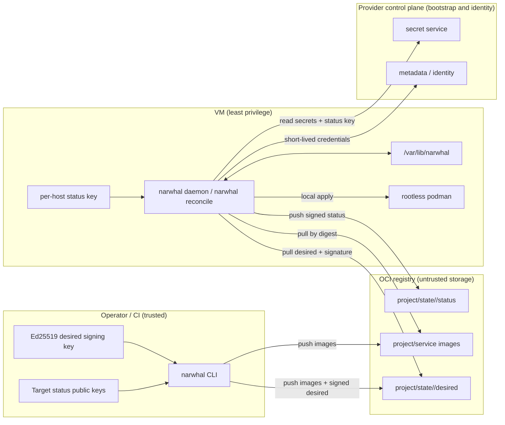
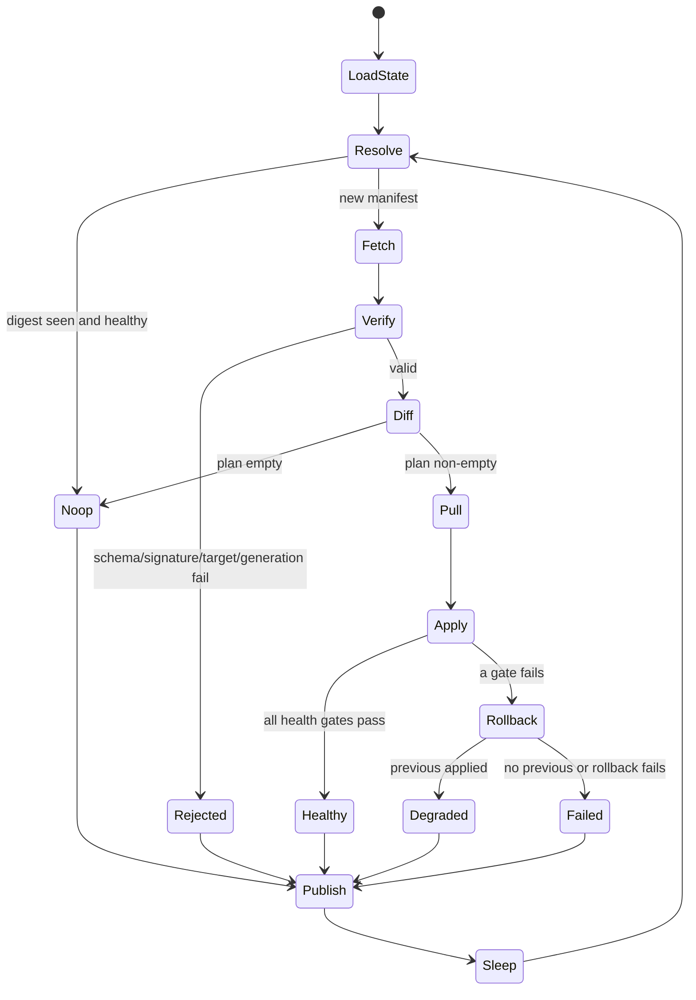

# Narwhal cloud deployment design

Status: draft for implementation
Scope: AWS, DigitalOcean, Google Cloud (GCP)
Date: 2026-11-24
Revision: post-review remediation

This document specifies how `narwhal` deploys a project to a VM in AWS,
DigitalOcean, or GCP without an inbound control path. It is a design, not an
implementation plan for code that already exists. It is intentionally narrower
than a general orchestrator.

Fixed constraints, restated so every section can be checked against them:

- Only AWS, DigitalOcean, and GCP are in scope.
- The runtime is a VM running rootless podman.
- Images are built by `narwhal` and pushed to an OCI registry.
- There is no SSH, no bastion, and no inbound control-plane port.
- Data-plane ingress is explicit per target: port, protocol, and source. It is
  empty by default.
- The host pulls a signed desired-state artifact from the registry, reconciles
  locally, and publishes signed status back to the registry.
- `narwhal reconcile` (one-shot) and `narwhal daemon` (polling agent) use one reconcile
  engine.
- A systemd user timer is the fallback when the agent is not used.
- AWS SSM State Manager is optional, AWS only, and never the transport.
- OpenTofu provisions infrastructure, including registries, per provider.

---

## 1. Goals, non-goals, threat model, trust boundaries

### 1.1 Goals

1. A deployment is one signed, immutable desired-state document. If the host
   has that document and its images, it can converge with no call back to the
   operator.
2. The agent never listens on a control port. There is no control-plane ingress.
   Data-plane ingress is explicit per target as port/protocol/source rules, and
   defaults to none.
3. A registry compromise cannot change what runs. An attacker who can overwrite
   tags or manifests still cannot produce a valid operator signature.
4. A replayed old artifact cannot roll a host back. Generation numbers are
   monotonic and persisted.
5. Reconciliation is idempotent. Running it twice does not restart containers,
   re-pull images, or rewrite status unnecessarily.
6. Failures are visible. Signature failures, health failures, registry outages,
   credential expiry, and trust failures all produce an explicit phase and error
   code in a signed status document.
7. The provider surface is small and explicit. Provider-specific code is
   limited to bootstrap, identity, secret access, registry provisioning,
   registry authentication, provider firewall reconciliation, and OpenTofu
   resources. The artifact, reconciliation, status, and CLI are
   provider-neutral.

### 1.2 Non-goals

- A scheduler or orchestrator. One VM per target. No placement, bin packing, or
  replication.
- Zero-downtime rolling updates. A single VM restart can drop traffic.
- Autoscaling, self-healing across hosts, or multi-region failover.
- Building images on the VM. Images are built by `narwhal` on an operator or CI
  host and pushed by digest.
- A secrets manager. Narwhal reads from the provider's secret service or from a
  local file. It does not store, replicate, or rotate secret values.
- A managed ingress controller, TLS termination, DNS, or load balancing.
  Data-plane ingress is only the declared target rules. TLS is the operator's
  concern.
- Windows containers, Kubernetes, or managed container services.
- A remote shell, log streaming tunnel, or inbound control port.
- Using an interactive provider console as a deployment or recovery path.
  Recovery is reprovisioning or provider control-plane replacement.

### 1.3 Actors and assets

| Actor | Holds | Trust |
| --- | --- | --- |
| Operator or CI | Desired-state signing key, registry write credentials | Trusted to author state |
| Registry | Desired artifacts, signatures, images, status | Untrusted for integrity, trusted for availability |
| VM host | Agent, read credentials, provider identity, per-host status key | Compromisable, constrained by least privilege |
| Provider control plane | Boot configuration, IAM, metadata service, secret service | Trusted at bootstrap and for scoped runtime credentials/secrets; never the desired-state transport |
| Workload container | Application code, no agent credentials | Untrusted |

Assets, in order of importance:

1. The desired-state signing private key.
2. Integrity of the desired-state document and image digests.
3. Secret values delivered to workloads.
4. Provider identity credentials held by the host.
5. The per-host status signing key.
6. Availability of the running workload.
7. Authenticity of status reports.

### 1.4 Threats and mitigations

| Threat | Mitigation |
| --- | --- |
| Registry tag overwrite | Desired payload and signature are separate layers. The agent verifies the signature over canonical bytes before parsing or pulling anything. |
| Replay of an old signed artifact | Persisted `highest_generation`. Reject any `generation <= highest_generation` except an identical digest at the same generation. Rollback is published as a new generation. |
| Man-in-the-middle on registry traffic | TLS with normal system trust. The signature still protects integrity if TLS is terminated by a compromised proxy. |
| Stolen host registry credentials | Read-only on desired and image repositories, write-only on the status repository, and status is signed by a per-host key the operator verifies. A status repository write credential alone cannot forge a trusted status. |
| Compromised host status private key | The per-host signature stops registry-only forgery, not a host that holds its own key. A compromised host can sign arbitrary status for itself. Detecting that requires host attestation, which is outside this design. |
| Compromised container reaching instance metadata | AWS: IMDSv2 required, but hop limit 1 does not reliably block slirp4netns or pasta userspace networking, so add a container-network egress block to `169.254.169.254` (not a host-wide block, which would break the agent's own credentials) or a metadata proxy, plus a container probe. GCP: minimal service-account roles, the same container-network block or metadata proxy, and a probe. DigitalOcean: no instance identity to steal, only the bootstrap token. |
| Secret leakage through the artifact | The schema carries secret references, not values. Literal `env` is allowed but documented as non-secret. The agent redacts resolved secret values from status log tails and never writes them to the journal. |
| Malicious image | Images are referenced by digest recorded in the signed artifact. Build provenance is outside this design. |
| Signing key compromise | Key rotation with multi-signature and a signed effective trust set. Full compromise of the key defeats the model until the trust set is changed out of band. |
| Registry-only status forgery | Status is signed with a per-host Ed25519 key registered in target configuration. Consumers verify the signature and reject unsigned or wrongly signed status written with only a registry credential. |
| Agent self-upgrade supply chain | Agent image digest and binary SHA-256 are inside the signed desired artifact. The agent stages, verifies, swaps atomically, reverts on repeated start failure, and records the failed digest as blocked so it is not retried. |
| Lost or wiped `state.json`, journal, or cache | Ordering recovers from the latest signed status, and the agent accepts the current valid artifact. The effective trust set is not state: `/var/lib/narwhal/trust.json` is preserved. If trust material is lost or corrupt, the durable root-owned `/etc/narwhal/bootstrap-complete` marker makes bootstrap fail closed; recovery requires trust restoration or reprovisioning, not silent regeneration. An attacker who can also serve an old valid artifact after state loss can cause a rollback. This is stated explicitly. |

### 1.5 Trust boundaries



The registry is trusted for availability and untrusted for integrity. The
provider control plane is trusted for the initial bootstrap (image, user-data,
trust keys, status key delivery) and, after bootstrap, for issuing scoped,
short-lived credentials and secret values to the host. It is not on the
desired-state transport path: desired state is pulled from the registry and
verified locally, and no provider API can inject a desired artifact. The
workload never receives write access to the registry or any signing key.

---

## 2. Desired-state artifact

### 2.1 Registry location and immutable addressing

The design separates the image registry from the state registry:

- `image_registry` stores service images and the narwhal agent image.
- `state_registry` stores desired-state and status artifacts.

They may be the same registry for AWS and GCP. They must be separate for
DigitalOcean, because DOCR credentials are account-wide and a host must not hold
a credential that can push anywhere in the image account. The state registry for
DigitalOcean is a non-DOCR registry or a registry in a separate DigitalOcean
account with its own token.

Default layout:

```text
<image_registry>/<project>/<service>                    image repositories
<image_registry>/<project>/narwhal                      agent image
<state_registry>/<project>/state/<target>/desired       desired-state OCI artifacts
<state_registry>/<project>/state/<target>/status        status OCI artifacts
```

`<project>` is the manifest project name and must match
`^[a-z0-9]([a-z0-9._-]{0,61}[a-z0-9])?$`, the same rule as
`Manifest.cs`/`ManifestLoader.cs`. The `state/` path component keeps control
artifacts out of the service namespace. A service named `state` produces
`<project>/state`, not `<project>/state/<target>/desired`, so there is no
collision.

`<target>` is a stable, repository-safe identifier derived from the target
tuple:

```text
target_id = "<provider>-<region>-<arch>-<selector-hash>"
selector-hash = first 8 lowercase hex characters of SHA-256(JCS(target.selector))
```

Example: `aws-us-east-1-amd64-1a2b3c4d`. The identifier is lowercased and any
character outside `[a-z0-9-]` is replaced with `-`. Version 1 assumes exactly
one VM per `target_id`. Multiple VMs sharing one `target_id` would also share a
status document, so that is out of scope until status is partitioned by host.

Desired artifacts are OCI image manifests with two layers:

| Layer | Media type | Content |
| --- | --- | --- |
| payload | `application/vnd.narwhal.desired.v1+json` | Canonical JSON desired state |
| signature | `application/vnd.narwhal.signature.v1+json` | Signature envelope |

Manifest shape:

```json
{
  "schemaVersion": 2,
  "mediaType": "application/vnd.oci.image.manifest.v1+json",
  "artifactType": "application/vnd.narwhal.desired.v1+json",
  "config": {
    "mediaType": "application/vnd.oci.empty.v1+json",
    "digest": "sha256:44136fa355b3678a1146ad16f7e8649e94fb4fc21fe77e8310c060f61caaff8a",
    "size": 2
  },
  "layers": [
    {
      "mediaType": "application/vnd.narwhal.desired.v1+json",
      "digest": "sha256:<payload-digest>",
      "size": 4812
    },
    {
      "mediaType": "application/vnd.narwhal.signature.v1+json",
      "digest": "sha256:<signature-digest>",
      "size": 231
    }
  ],
  "annotations": {
    "org.opencontainers.image.created": "2026-11-24T18:30:00Z",
    "dev.narwhal.project": "shop",
    "dev.narwhal.generation": "42",
    "dev.narwhal.target": "aws-us-east-1-amd64-1a2b3c4d"
  }
}
```

Tags, within the target-specific desired repository:

- `g<generation>` is an immutable convenience tag. It must never be moved. The
  payload digest, not the tag, is the identity.
- `desired` is a mutable alias to the highest published generation for that
  target repository. The agent may pull by this alias, but it records the
  manifest digest and never trusts the alias for ordering.
- A pinned deployment may configure `desired@sha256:<manifest-digest>` instead
  of the alias. This is the air-gapped and high-assurance mode.

Immutability is the manifest digest and the payload digest. Tags are only
discovery hints. The agent verifies the payload signature even when the tag is
pinned.

If a registry rejects `artifactType` on an OCI manifest, the fallback is a
normal OCI image manifest with no `artifactType`. The config is a minimal OCI
image config blob of media type `application/vnd.oci.image.config.v1+json`
whose content is `{}`. The payload and signature layer media types remain the
same. The same fallback shape applies to desired and status artifacts. This
fallback is exercised on DOCR and ECR in acceptance.

### 2.2 Exact desired-state schema

The payload is canonical JSON (RFC 8785, JCS) and must validate against this
schema. The schema is normative for field names, types, and required fields.
Additional semantic checks are listed in 2.3.

```json
{
  "$schema": "https://json-schema.org/draft/2020-12/schema",
  "$id": "https://narwhal.dev/schemas/desired-v1.schema.json",
  "title": "narwhal desired state v1",
  "type": "object",
  "additionalProperties": false,
  "required": [
    "schema",
    "version",
    "project",
    "generation",
    "created",
    "target",
    "images",
    "services"
  ],
  "properties": {
    "schema": { "const": "narwhal.desired/v1" },
    "version": { "const": 1 },
    "project": {
      "type": "string",
      "pattern": "^[a-z0-9]([a-z0-9._-]{0,61}[a-z0-9])?$"
    },
    "generation": {
      "type": "integer",
      "minimum": 1,
      "maximum": 9007199254740991
    },
    "created": { "type": "string", "format": "date-time" },
    "previous": {
      "oneOf": [
        { "type": "null" },
        { "$ref": "#/$defs/artifactRef" }
      ]
    },
    "target": { "$ref": "#/$defs/target" },
    "trust": {
      "type": "array",
      "minItems": 1,
      "items": { "$ref": "#/$defs/trustedKey" }
    },
    "images": {
      "type": "object",
      "minProperties": 1,
      "propertyNames": { "pattern": "^sha256:[0-9a-f]{64}$" },
      "additionalProperties": { "$ref": "#/$defs/image" }
    },
    "services": {
      "type": "object",
      "minProperties": 1,
      "additionalProperties": { "$ref": "#/$defs/service" }
    },
    "deploy": { "$ref": "#/$defs/deploy" },
    "agent": { "$ref": "#/$defs/agent" }
  },
  "$defs": {
    "artifactRef": {
      "type": "object",
      "additionalProperties": false,
      "required": ["generation", "digest", "manifest_digest"],
      "properties": {
        "generation": { "type": "integer", "minimum": 1 },
        "digest": { "type": "string", "pattern": "^sha256:[0-9a-f]{64}$" },
        "manifest_digest": { "type": "string", "pattern": "^sha256:[0-9a-f]{64}$" }
      }
    },
    "target": {
      "type": "object",
      "additionalProperties": false,
      "required": ["provider", "region", "arch", "selector", "ingress"],
      "properties": {
        "provider": { "enum": ["aws", "digitalocean", "gcp"] },
        "region": { "type": "string", "minLength": 1 },
        "arch": { "enum": ["amd64", "arm64"] },
        "selector": {
          "type": "object",
          "minProperties": 1,
          "additionalProperties": { "type": "string", "minLength": 1 }
        },
        "ingress": {
          "type": "array",
          "items": { "$ref": "#/$defs/ingressRule" }
        }
      }
    },
    "ingressRule": {
      "type": "object",
      "additionalProperties": false,
      "required": ["protocol", "port", "source"],
      "properties": {
        "protocol": { "enum": ["tcp", "udp"] },
        "port": { "type": "integer", "minimum": 1, "maximum": 65535 },
        "source": {
          "type": "array",
          "minItems": 1,
          "uniqueItems": true,
          "items": { "type": "string", "minLength": 1 }
        }
      }
    },
    "trustedKey": {
      "type": "object",
      "additionalProperties": false,
      "required": ["key_id", "public_key"],
      "properties": {
        "key_id": {
          "type": "string",
          "pattern": "^[0-9a-f]{16}$"
        },
        "public_key": {
          "type": "string",
          "contentEncoding": "base64"
        },
        "not_after": { "type": "string", "format": "date-time" }
      }
    },
    "image": {
      "type": "object",
      "additionalProperties": false,
      "required": ["repository", "platform", "size"],
      "properties": {
        "repository": {
          "type": "string",
          "pattern": "^[a-z0-9]+([._-][a-z0-9]+)*(:[0-9]+)?(/[a-z0-9]+([._-][a-z0-9]+)*)+$"
        },
        "platform": { "enum": ["linux/amd64", "linux/arm64"] },
        "size": { "type": "integer", "minimum": 1 }
      }
    },
    "service": {
      "type": "object",
      "additionalProperties": false,
      "required": ["image"],
      "properties": {
        "image": {
          "type": "string",
          "pattern": "^sha256:[0-9a-f]{64}$"
        },
        "command": {
          "type": "array",
          "items": { "type": "string" }
        },
        "entrypoint": { "type": "string" },
        "env": {
          "type": "object",
          "additionalProperties": { "type": "string" }
        },
        "secrets": {
          "type": "object",
          "additionalProperties": { "$ref": "#/$defs/secretRef" }
        },
        "ports": {
          "type": "array",
          "items": {
            "type": "string",
            "pattern": "^[0-9]{1,5}(:[0-9]{1,5}){0,2}(/(tcp|udp|sctp))?$"
          }
        },
        "volumes": {
          "type": "array",
          "items": { "type": "string" }
        },
        "health": {
          "oneOf": [
            { "type": "null" },
            { "$ref": "#/$defs/health" }
          ]
        },
        "depends_on": {
          "type": "array",
          "items": { "type": "string" },
          "uniqueItems": true
        },
        "restart": {
          "enum": ["no", "on-failure", "always", "unless-stopped"]
        },
        "user": { "type": "string" },
        "workdir": { "type": "string" },
        "stop_timeout": {
          "type": "integer",
          "minimum": 1,
          "maximum": 300
        }
      }
    },
    "secretRef": {
      "type": "object",
      "additionalProperties": false,
      "required": ["source", "id"],
      "properties": {
        "source": {
          "enum": [
            "aws-ssm",
            "aws-secretsmanager",
            "gcp-secretmanager",
            "digitalocean-secrets",
            "file"
          ]
        },
        "id": { "type": "string", "minLength": 1 },
        "version": { "type": "string" },
        "key": { "type": "string" }
      }
    },
    "health": {
      "type": "object",
      "additionalProperties": false,
      "required": ["command", "interval", "timeout", "retries"],
      "properties": {
        "command": { "type": "string", "minLength": 1 },
        "interval": { "type": "integer", "minimum": 1, "maximum": 300 },
        "timeout": { "type": "integer", "minimum": 1, "maximum": 300 },
        "retries": { "type": "integer", "minimum": 1, "maximum": 100 },
        "start_period": { "type": "integer", "minimum": 0, "maximum": 3600 }
      }
    },
    "deploy": {
      "type": "object",
      "additionalProperties": false,
      "properties": {
        "network": { "type": "string" },
        "wait_seconds": { "type": "integer", "minimum": 1, "maximum": 3600 }
      }
    },
    "agent": {
      "type": "object",
      "additionalProperties": false,
      "required": ["version", "repository", "digest", "binary_sha256"],
      "properties": {
        "version": { "type": "string", "minLength": 1 },
        "repository": { "type": "string", "minLength": 1 },
        "digest": {
          "type": "string",
          "pattern": "^sha256:[0-9a-f]{64}$"
        },
        "binary_sha256": {
          "type": "string",
          "pattern": "^[0-9a-f]{64}$"
        }
      }
    }
  }
}
```

Field notes:

- `version` is the schema major version and is currently `1`. `schema` is the
  document type discriminator. A document with an unknown `version` or `schema`
  is rejected before any other field is interpreted.
- `generation` is the only ordering signal. `created` is informational and must
  not be used for conflict resolution.
- `previous` points to the previous desired payload for the same target. Its
  `digest` is the canonical payload digest. Its `manifest_digest` is the
  manifest digest at `g<generation>`, so rollback and recovery can fetch and
  verify the exact previous manifest, signature, and payload.
- `target.selector` is a non-empty string map. The agent's configured target
  must equal `provider`, `region`, and `arch`, and every selector pair must
  match exactly. Extra selector keys on the agent are allowed.
- `target.ingress` is the complete data-plane ingress set for the target. An
  empty array means no data-plane ingress. It is signed. `narwhal deploy`
  reconciles the provider firewall in the two-phase order in 4.5 and 6.3:
  revoke removed rules before publishing, then publish, then authorize added
  rules. OpenTofu creates the empty managed firewall at bootstrap. The agent
  does not open ports or change firewall rules.
- `images` is keyed by image digest. `service.image` must name a key in
  `images`. `images[digest].platform` must equal `linux/<target.arch>`.
- `repository` has no tag and no digest. Pulls are always
  `<repository>@<digest>`.
- `env` values are literal, non-secret strings. `secrets` is the only way to
  reference secret material. A key must not appear in both maps.
- `ports` preserves the existing manifest parser: one to three colon-separated
  numeric parts and an optional `tcp`, `udp`, or `sctp` suffix. A single part is
  a container port with an ephemeral host port. It is allowed by the parser but
  cannot be named by an ingress rule, so published cloud services should use
  `host:container`.
- `volumes` uses the existing named-volume or absolute-path syntax. Absolute
  bind mounts must be under `/srv/narwhal/` and must already exist. The agent
  never creates host directories from the artifact.
- `health` is optional. `null` and omission both mean no container health check.
- `restart` defaults to `unless-stopped`.
- `agent` is optional. When present, it authorizes an agent upgrade. See
  section 5.2.
- `trust` is optional. When present, it replaces the effective trust set after a
  successful verification by a key in the intersection of the old and new sets.
  See 2.6.

Schema evolution: additive optional fields stay in `narwhal.desired/v1`. A
breaking change bumps `version` and the `schema` discriminator together, and
the agent rejects an unknown pair before interpreting any other field.

Example payload:

```json
{
  "schema": "narwhal.desired/v1",
  "version": 1,
  "project": "shop",
  "generation": 42,
  "created": "2026-11-24T18:30:00Z",
  "previous": {
    "generation": 41,
    "digest": "sha256:bbbbbbbbbbbbbbbbbbbbbbbbbbbbbbbbbbbbbbbbbbbbbbbbbbbbbbbbbbbbbbbb",
    "manifest_digest": "sha256:cccccccccccccccccccccccccccccccccccccccccccccccccccccccccccccccc"
  },
  "target": {
    "provider": "aws",
    "region": "us-east-1",
    "arch": "amd64",
    "selector": { "stack": "prod" },
    "ingress": [
      { "protocol": "tcp", "port": 8080, "source": ["203.0.113.0/24"] }
    ]
  },
  "trust": [
    {
      "key_id": "9f2c41d0a7b3e815",
      "public_key": "uX1n0m9Qb2VJ7l0mF1c8oQ3i4p5r6s7t8u9v0w1x2y3="
    }
  ],
  "images": {
    "sha256:aaaaaaaaaaaaaaaaaaaaaaaaaaaaaaaaaaaaaaaaaaaaaaaaaaaaaaaaaaaaaaaa": {
      "repository": "registry.example.com/shop/api",
      "platform": "linux/amd64",
      "size": 48231011
    },
    "sha256:cccccccccccccccccccccccccccccccccccccccccccccccccccccccccccccccc": {
      "repository": "registry.example.com/shop/db",
      "platform": "linux/amd64",
      "size": 158220144
    }
  },
  "services": {
    "db": {
      "image": "sha256:cccccccccccccccccccccccccccccccccccccccccccccccccccccccccccccccc",
      "env": {
        "POSTGRES_DB": "shop",
        "POSTGRES_USER": "shop"
      },
      "secrets": {
        "POSTGRES_PASSWORD": {
          "source": "aws-ssm",
          "id": "/shop/prod/db-password"
        }
      },
      "volumes": ["shop-db:/var/lib/postgresql/data"],
      "health": {
        "command": "pg_isready -U shop -d shop",
        "interval": 2,
        "timeout": 3,
        "retries": 30,
        "start_period": 10
      },
      "restart": "unless-stopped",
      "stop_timeout": 30
    },
    "api": {
      "image": "sha256:aaaaaaaaaaaaaaaaaaaaaaaaaaaaaaaaaaaaaaaaaaaaaaaaaaaaaaaaaaaaaaaa",
      "command": ["/bin/api", "serve"],
      "env": {
        "LOG_LEVEL": "info",
        "DATABASE_HOST": "db"
      },
      "secrets": {
        "DATABASE_PASSWORD": {
          "source": "aws-ssm",
          "id": "/shop/prod/db-password"
        }
      },
      "ports": ["8080:8080"],
      "depends_on": ["db"],
      "health": {
        "command": "wget -q -O /dev/null http://127.0.0.1:8080/healthz",
        "interval": 2,
        "timeout": 3,
        "retries": 20
      },
      "restart": "unless-stopped",
      "stop_timeout": 10
    }
  },
  "deploy": {
    "network": "shop",
    "wait_seconds": 60
  },
  "agent": {
    "version": "0.3.0",
    "repository": "registry.example.com/shop/narwhal",
    "digest": "sha256:dddddddddddddddddddddddddddddddddddddddddddddddddddddddddddddddd",
    "binary_sha256": "eeeeeeeeeeeeeeeeeeeeeeeeeeeeeeeeeeeeeeeeeeeeeeeeeeeeeeeeeeeeeeee"
  }
}
```

### 2.3 Semantic validation beyond the schema

The agent validates these rules after JSON Schema validation and before any
image pull:

1. `service.image` exists in `images`.
2. `images[service.image].platform == "linux/" + target.arch`.
3. Every `depends_on` entry names an existing service. The graph is acyclic.
4. `env` and `secrets` key sets are disjoint.
5. Every `volume` is a named volume or an absolute path under `/srv/narwhal/`.
6. Every `port` matches the existing parser and every numeric part is in
   `1..65535`. A host port is required for a service that is meant to be reached
   through target ingress.
7. Every `ingress.source` is a valid IPv4 or IPv6 CIDR. Every `ingress.port` is
   in `1..65535`. The set is duplicate-free.
8. Every `trust` entry satisfies `key_id == first 8 bytes of
   SHA-256(public_key)`, encoded as 16 lowercase hex characters (bytes at
   indices 0-7).
9. `generation > previous.generation` when `previous` is present.
10. `previous` is either `null` or both its `digest` and `manifest_digest`
    resolve to the artifact at `g<generation>`, verify against the effective
    trust set, and match the referenced payload. The agent does not require the
    previous payload to be cached; it refetches by `g<generation>`.
11. `services` has at least one service and every service has an image.
12. No service uses privileged mode, host networking, or added capabilities.
    These fields do not exist in the schema, so a document that sets them fails
    schema validation.
13. No `target.ingress` rule uses port 22. The control-plane rule set is empty.
14. `project` uses the same rule as existing manifest name validation:
    lowercase letters, digits, `.`, `_`, and `-`, starting and ending
    alphanumeric, at most 63 characters. Cloud does not narrow existing valid
    project names.
15. A rule may mix IPv4 and IPv6 sources. The provider adapter splits the
    `source` list by address family; a provider that cannot express both
    families in one rule gets one managed rule per family.

Ingress and service ports are not automatically coupled. A service can be
internal-only. `narwhal deploy` warns when a declared host port has no matching
`target.ingress` rule, because the port will not be reachable from outside the
VM. It also warns when an ingress rule names a port that no service publishes.

### 2.4 Canonicalization and digest

The payload layer bytes are the UTF-8 encoding of the JSON Canonicalization
Scheme form of the document, with these restrictions:

- No insignificant whitespace.
- Object keys sorted by UTF-16 code units, as JCS requires.
- Integers only. No floating point numbers, no exponent notation.
- Strings escaped exactly as JCS requires, including `\u` escapes for control
  characters.
- No Unicode normalization. `created` is an RFC 3339 UTC timestamp with `Z`.

`payload_digest = "sha256:" + lowercase_hex(SHA-256(canonical_bytes))`.

The payload layer digest must equal `payload_digest`. The agent recomputes it and
rejects a mismatch before signature verification.

### 2.5 Signing scheme

Recommended: Ed25519 detached signatures over the canonical bytes, with a
small, multi-signature envelope.

Why Ed25519:

- 32-byte public keys, 64-byte signatures, deterministic signing.
- Implementable from .NET AOT with no native dependency. As of 2026-11-24,
  .NET 11 does not ship Ed25519 in `System.Security.Cryptography`. The runtime
  issue tracking in-box support is still open, and only X25519 key agreement is
  shipping. A small managed RFC 8032 implementation, or a managed-only package
  such as `Chaos.NaCl` or BouncyCastle, satisfies AOT and avoids libsodium.
  The project should vendor one implementation with RFC 8032 test vectors rather
  than take a native dependency.
- If the project later forbids third-party cryptography, the envelope has an
  `alg` field and an in-box ECDSA P-256/SHA-256 option can be added without
  changing the artifact layout. Ed25519 remains the default.

Signed message, with domain separation:

```text
message = ASCII("narwhal.desired/v1\n") || canonical_payload_bytes
signature = Ed25519-Sign(private_key, message)
```

The domain separator prevents a signature from being reused as a signature over
some other narwhal document. It is not a substitute for the payload digest,
which is checked separately.

Signature envelope, stored in the signature layer:

```json
{
  "schema": "narwhal.signature/v1",
  "payload_digest": "sha256:aaaaaaaaaaaaaaaaaaaaaaaaaaaaaaaaaaaaaaaaaaaaaaaaaaaaaaaaaaaaaaaa",
  "signatures": [
    {
      "alg": "ed25519",
      "key_id": "9f2c41d0a7b3e815",
      "sig": "base64url(64-byte Ed25519 signature)"
    }
  ]
}
```

This is deliberately not a minisign file. minisign bundles a comment line and
its own key file format, while this envelope needs explicit key IDs and several
signatures for rotation. The signature primitive is the same Ed25519.

`key_id` is the first 8 bytes of SHA-256 of the 32-byte public key, encoded as
16 lowercase hex characters. Verification requires at least one signature whose
`key_id` matches a key in the effective trust set whose `not_after` has not
passed.

Key files:

- Private key: PKCS#8 Ed25519 PEM, mode `0600`, never on a VM. Generated by
  `narwhal keys generate`. The signing CLI reads it from
  `[cloud].signing_key` or `NARWHAL_SIGNING_KEY`.
- Boot pin: root-owned file `/etc/narwhal/trust/<key_id>.pub` containing:

  ```text
  narwhal-ed25519-v1 <base64(32-byte public key)>
  not_after=2027-11-24T00:00:00Z
  ```

The boot pins are the initial trust roots. The effective trust set, described in
2.6, is what the agent uses to verify artifacts. The agent checks that the boot
pin directory is present and well formed at startup, but it does not treat the
pins as the effective set after bootstrap. A missing or malformed boot pin
directory is a fatal startup error. A validly signed artifact with no matching
trusted key is a verification failure, not a crash.

### 2.6 Effective trust set, rotation, and revocation

One term is used everywhere: the **effective trust set**.

- Boot pins live in `/etc/narwhal/trust/*.pub`. They are immutable to the agent.
- Bootstrap writes the initial effective set to `/var/lib/narwhal/trust.json`
  from the boot pins only on a true first boot: the file is absent and
  `/etc/narwhal/bootstrap-complete` is also absent. It is owned by
  `narwhal`, mode `0600`, and is the authoritative effective set from that
  point on. Bootstrap refuses an empty boot-pin set and never replaces an
  existing valid set.
- `/etc/narwhal/bootstrap-complete` is a durable root-owned marker written
  after the first successful trust initialization and status-key/config/unit
  setup. It is not writable by `narwhal`, so neither the agent nor a wipe of
  `/var/lib/narwhal` can remove it. If the marker exists and `trust.json` is
  missing or invalid, bootstrap fails closed with `trust_set_invalid` and does
  not reseed from boot pins. Deleting `trust.json` is trust loss, not a first
  boot.
- The agent parses and structurally verifies `/var/lib/narwhal/trust.json` at
  startup and after every rotation.
- If `trust.json` is missing or corrupt, the agent fails closed. It does not
  fall back to boot pins, does not pull images, and publishes
  `last_error.code="trust_set_invalid"`.
- After a successful rotation, the agent writes the new effective set to
  `/var/lib/narwhal/trust.json` atomically. A failed write leaves the previous file
  intact and fails the rotation closed.
- Every entry in the effective set must satisfy `key_id == first 8 bytes of
  SHA-256(public_key)`, encoded as 16 lowercase hex characters (bytes at
  indices 0-7). Any mismatch fails the whole set closed.
- A key whose `not_after` has passed is not trusted. An artifact verified only
  by an expired key fails.

Rotation procedure:

1. Generate a new key pair. Add it to the repository's `[cloud].trust`
   configuration and to the OpenTofu boot-pin variable for future reprovisions.
2. Deploy a generation signed by both the old and new keys. The payload's
   `trust` array contains both keys.
3. Agents that trust the old key accept the artifact, verify the dual signature,
   and replace the effective set with the new array. `trust.json` is rewritten
   atomically.
4. Deploy a generation signed only by the new key and containing only the new
   key in `trust`.
5. Remove the old key from operator stores. Keep it in boot pins until every
   host has rotated, then remove it through a reprovision.

Boot-pin updates are infrastructure changes. The agent cannot write
`/etc/narwhal/trust`. If boot pins are replaced without overlap with the current
effective set, the next host that loses `trust.json` will fail closed. Treat the
boot pins as a recovery root, not the primary rotation channel.

Revocation:

- Remove the revoked key from `trust` in a payload signed by a remaining trusted
  key. The new set must contain every key that verifies the artifact.
- An artifact signed only by a revoked key is rejected, even if it was valid
  before.
- Removing the last key that verifies the artifact is rejected. The agent never
  accepts an empty effective set.
- If the only remaining key is compromised, the recovery is an out-of-band
  reprovision with new boot pins signed by an out-of-band trusted key. There is
  no self-service path from an empty set.

### 2.7 Replay, generation allocation, and rollback source

The agent persists, per target:

```text
highest_generation      highest generation ever accepted
highest_payload_digest  payload digest of that generation
active_generation       generation currently applied
blocked_generation      generation that failed health and must not be retried
blocked_agent_digest    canonical sha256:<hex> digest of an agent binary that failed self-upgrade
agent_rollback_version  last known-good agent version after a revert
last_agent_revert_digest  canonical digest of the last revert already reported
status_epoch            status ordering epoch
status_seq              status ordering sequence
```

Acceptance rules:

- `generation > highest_generation`: accept if signature, target, schema, and
  digest are valid.
- `generation == highest_generation` and payload digest equals the accepted
  digest: idempotent no-op. This supports a crash between accept and apply.
- `generation == highest_generation` and payload digest differs: reject with
  `generation_conflict`. Two different payloads cannot share a generation for
  one target.
- `generation < highest_generation`: reject as a replay, even if the signature
  is valid. The status error code is `generation_replay`.
- The agent caches the manifest digest it last rejected for a signature, schema,
  or target failure. It does not re-fetch and re-reject that exact digest until
  the tag resolves to a different digest.
- After a health failure at generation N, `blocked_generation = N`. The agent
  does not retry N while the registry alias still points at it. A generation
  greater than N is eligible.
- After an agent self-upgrade failure, `blocked_agent_digest` is the SHA-256 of
  the failed binary. The agent keeps running `agent_rollback_version` and does
  not stage the same digest again, even if the desired artifact still names it.
  A later signed generation that names a different agent digest is eligible.
  Reprovisioning clears the block.

Define:

```text
current_generation = max(highest_generation, active_generation)
```

`narwhal rollback` uses `current_generation + 1` for the new artifact. Its
default service source is the payload at `active_generation`, meaning the last
successfully applied payload. If `active_generation` is null, there is nothing
to roll back. `--to-generation N` is an explicit override and must refer to a
payload whose signature verifies against the effective trust set. The CLI never
uses an unsigned status document to choose a generation.

`narwhal deploy` allocates `generation + 1` from the signed desired artifact
only. It never derives a generation from status. If no desired artifact exists,
it starts at generation 1. If desired exists but cannot be read and verified, it
refuses unless `--generation` is given explicitly.

Generation allocation is single-writer per target. `narwhal deploy` reads the
current signed `desired` manifest digest and generation, signs
`generation + 1`, then re-reads the tag before pushing. If the tag moved, the
deploy aborts and retries from the new value. Registries do not all support a
conditional tag update, so two simultaneous deploys can still race. If they do,
both payloads share a generation, the agent accepts the first and rejects the
second with `generation_conflict`, and the operator must publish a higher
generation. Do not run concurrent deploys for one target.

The agent does not use wall-clock time to order artifacts. A host with a wrong
clock still orders correctly by generation. Time is used only for log
timestamps, signature `not_after`, and status freshness.

---

## 3. Pull agent and reconcile engine

### 3.1 Process model

There is one engine, `Narwhal.Reconcile`, used by both entry points:

- `narwhal daemon`: a long-running systemd **user** service for the `narwhal` user.
  It polls, applies, signs and publishes status, and repeats.
- `narwhal reconcile`: a one-shot invocation of the same engine. Intended for a
  systemd **user** timer, manual recovery, or the optional AWS SSM association.

The agent and timer run in the `narwhal` user manager, not a root system unit.
This is deliberate: rootless podman containers are children of the user manager,
and a root service cannot reliably own or supervise them. Bootstrap enables
lingering:

```text
loginctl enable-linger narwhal
```

The agent and timer are enabled with `systemctl --user` as the `narwhal` user.
If the user manager is not running during bootstrap, bootstrap starts
`user@<uid>.service` first. Bootstrap uses the user's runtime environment
explicitly:

```text
runuser -u narwhal -- env \
  XDG_RUNTIME_DIR=/run/user/<uid> \
  DBUS_SESSION_BUS_ADDRESS=unix:path=/run/user/<uid>/bus \
  systemctl --user enable --now narwhal.service
```

A `flock` on `/var/lib/narwhal/lock` serializes the daemon and one-shot. A
one-shot run that cannot take the lock exits `0` with "another reconcile is
running" and does not touch state. The daemon holds the lock only for a reconcile
cycle, not while sleeping, so a manual one-shot can run between polls.
Upgrade markers use a separate `flock` on `/var/lib/narwhal/agent-upgrade.lock`.
The guard takes it non-blocking so it never waits behind a reconcile, and the
agent takes it while staging or reading markers.

Agent config, `/etc/narwhal/agent.toml`:

```toml
project = "shop"
image_registry = "registry.example.com"
state_registry = "state.example.net"
desired_repo = "shop/state/aws-us-east-1-amd64-1a2b3c4d/desired"
status_repo = "shop/state/aws-us-east-1-amd64-1a2b3c4d/status"
poll_seconds = 30
lock_timeout_seconds = 120
log_redact = ["Bearer ", "password="]

[target]
provider = "aws"
region = "us-east-1"
arch = "amd64"
selector = { stack = "prod" }
# log_redact may also be set here; target values replace root values.

mode = "daemon"            # "daemon" or "timer"
trust_dir = "/etc/narwhal/trust"
state_dir = "/var/lib/narwhal"
status_key = "/etc/narwhal/status-key"

[registry_auth]
# State-registry credential. Accepts username/password, token, credential_helper,
# and insecure, or NARWHAL_REGISTRY_USERNAME, _PASSWORD, _TOKEN,
# _CREDENTIAL_HELPER, and _INSECURE.
token = "<state-registry-token>"

[image_registry_auth]
# Image-pull credential when the image registry differs from the state registry.
# Accepts the same keys, or NARWHAL_IMAGE_REGISTRY_USERNAME, _PASSWORD, _TOKEN,
# _CREDENTIAL_HELPER, and _INSECURE.
username = "<image-registry-user>"
password = "<image-registry-password>"
```

Bootstrap writes `mode`. In `timer` mode the daemon user unit is disabled and
the timer user unit is enabled. Both modes run the same engine and produce the
same status.

`log_redact` is an array of literal strings removed from status error messages
and bounded log tails before they are signed. It may be set at the root or under
`[target]`; a target-level array replaces the root-level array.

`agent.toml` must be mode `0600` whenever it contains a plaintext `password` or
`token`; the loader rejects group- or other-readable files. Prefer
`credential_helper` or the `NARWHAL_*` environment variables to avoid storing a
plaintext secret in the file.

When `image_registry` equals the effective desired-state registry
(`state_registry ?? image_registry`) and `[image_registry_auth]` and
`NARWHAL_IMAGE_REGISTRY_*` are unset, the `[registry_auth]` credential is reused
for image pulls. An explicit `[image_registry_auth]` table or any
`NARWHAL_IMAGE_REGISTRY_*` variable overrides that reuse.

### 3.2 Loop



Default poll interval is 30 seconds with ±20% jitter. After a transport or
registry error, back off exponentially from 30 seconds to 5 minutes. After an
authentication failure, use the same backoff and publish `auth_failed` when the
status path is writable. After a verification or health failure, keep the normal
poll interval but do not reapply the blocked generation.

### 3.3 Verification order

Verification is fail-closed and happens before any image pull or container
mutation:

1. Resolve the desired reference to a manifest digest. If configured with a
   pinned digest, use it directly.
2. Fetch the manifest, select exactly one payload layer and one signature layer
   by media type. Reject zero or multiple candidates.
3. Fetch the payload and signature layer bytes.
4. Recompute `payload_digest` and compare with the signature envelope and the
   layer descriptor.
5. Parse the signature envelope. Verify at least one Ed25519 signature over
   `domain || payload` with a key in the effective trust set whose `not_after`
   has not passed.
6. Load and structurally verify the effective trust set. Every entry must have a
   matching key ID.
7. Parse the payload as UTF-8 JSON with no duplicate keys. Reject trailing bytes.
8. Validate against the desired schema.
9. Validate semantic rules from 2.3.
10. Validate `target` against the local configuration.
11. Validate project name.
12. Validate generation and digest against persisted state.
13. Apply any new `trust` set only after all checks pass.

Only then does the engine pull images. A failure at any step leaves the running
containers untouched and updates status with a specific error code.

### 3.4 Desired-versus-actual diff

Actual state is read from podman, not from a local model:

```text
podman ps --all --filter label=io.narwhal.project=<project> --format json
podman container inspect <name>
podman image inspect --format '{{json .RepoDigests}}' <repo>@<digest>
podman volume ls --filter label=io.narwhal.project=<project>
podman network inspect <network>
```

Containers are named `narwhal-<project>-<service>` and labeled:

```text
io.narwhal.project=<project>
io.narwhal.service=<service>
io.narwhal.generation=<generation>
io.narwhal.config-hash=<sha256 of the per-service canonical spec>
io.narwhal.image=<manifest digest>
```

The diff produces one action per service:

| Action | Condition |
| --- | --- |
| `create` | No container with the expected labels and name |
| `recreate` | Manifest digest, config hash, ports, mounts, env/secrets, health, or restart policy differ |
| `start` | Container exists but is stopped and the spec matches |
| `stop` | Container exists with the project label but is not in the desired set |
| `none` | All observed fields match |

The image comparison uses the registry manifest digest, not the podman image ID:

- `podman image inspect` must report a `RepoDigests` entry equal to
  `<repository>@<manifest-digest>`, or a `.Digest` equal to the manifest digest.
- `.Id` is the local config digest and must never be compared to a manifest
  digest. A missing `RepoDigests` entry means the local image cannot prove its
  registry origin. The agent re-pulls by digest instead of accepting it.

The config hash is computed from the canonical per-service object plus the
resolved secret version identifiers, not the secret values. Rotating a secret
version changes the hash and triggers a recreate on the next reconcile even if
the desired generation did not change. The secret value itself is never written
to the state directory or status.

Resolved secrets are injected as podman secrets:

```text
podman secret create <project>-<service>-<env> -        # value on stdin
podman run ... --secret <project>-<service>-<env>,type=env,target=<ENV>
```

The `target=<ENV>` part belongs on `podman run`, not on `podman secret create`.
The value is not placed in the container command line, the desired artifact, the
status, or the journal. The podman secret store lives under the rootless
graphroot in `/var/lib/narwhal/podman` and is mode `0600`. `type=env` support is
assumed for the Ubuntu 24.04 podman baseline and must be verified.

Named volumes are preserved across recreate. Orphan containers are removed only
after a successful apply. Orphan volumes are never removed automatically.

### 3.5 Dependency order, health gates, and rollback

Services are applied in topological order of `depends_on`. A cycle is rejected
during semantic validation, so an apply plan always exists.

For each service, in order:

1. Pull the image by digest if it is not already present. Verify the registry
   manifest digest using `RepoDigests` or `.Digest`, never `.Id`. A mismatch is a
   hard failure, not a fallback.
2. Create or recreate the container. Use `--pull=never` so a tag cannot be
   substituted for the pinned digest.
3. Start the container.
4. Wait for the health gate.

Health gate rules:

- With a `health` object: wait up to `retries * interval` seconds after
  `start_period` for podman health status `healthy`. `unhealthy`, `exited`, or
  timeout fails the gate.
- Without a health object: require the container to be running for 5 seconds and
  not restarting. This is intentionally weaker. Production services should
  define a health check.

On failure at service S:

1. Before changing any container, atomically persist `highest_generation` at the
   failed generation, `blocked_generation` at the failed generation, and
   `phase=rolling_back` in the journal. Fsync before changing any container.
   This is the durable record that the generation must never be re-applied.
2. Stop applying dependents. Do not start or recreate any service that depends
   on S.
3. Revert services already changed in this apply, in reverse dependency order,
   to the last successfully applied payload. If it is not cached, stop the
   changed containers and leave the rest alone.
4. Set `active_generation` to the last successfully applied generation, keep
   `highest_generation` at the failed generation, and keep `blocked_generation`
   at the failed generation.
5. If an active generation exists and the revert succeeded, publish
   `phase=degraded` with `last_error.service=S` and `last_error.code` set to
   `health_timeout` or `health_unhealthy`. If there is no active generation or
   the revert failed, publish `phase=failed` with `rollback_failed`.

If the artifact is validly signed but fails health, the host does not accept it
as active. It has observed it, so the highest generation advances. This is why
rollback is published forward as a new generation, not by moving the alias
backwards.

### 3.6 Idempotency and crash recovery

Every apply writes a journal entry before changing a container:

```json
{
  "schema": "narwhal.journal/v1",
  "generation": 42,
  "payload_digest": "sha256:...",
  "phase": "applying",
  "highest_generation": 42,
  "blocked_generation": null,
  "active_generation": 41,
  "actions": [
    { "service": "db", "action": "none" },
    { "service": "api", "action": "recreate" }
  ],
  "started_at": "2026-11-24T18:31:00Z"
}
```

The journal is written to a temporary file, fsynced, and renamed atomically. It
is the write-ahead record for generation state; recovery uses its
`highest_generation`, `blocked_generation`, and `active_generation` fields to
reconcile `state.json`. On startup:

- `phase=applying`: if the journal generation equals `blocked_generation`, do
  not re-run the diff. Finish the rollback to `active_generation`. Publish
  `phase=degraded` with the existing `blocked_generation` when an active
  generation exists, otherwise publish `phase=failed` with `rollback_failed`.
  Otherwise re-read podman state and re-run the diff. The apply is idempotent,
  so completed actions are skipped.
- `phase=rolling_back`: re-run the rollback diff and finish it. Publish
  `phase=degraded` when an active generation exists, otherwise `phase=failed`
  with `rollback_failed`.
- `phase=committed`: clear the journal.
- No journal: normal reconcile.

For container state, the journal is a hint and podman is the source of truth.
For generation state, the journal is the write-ahead record until `state.json`
is reconciled from it. If the journal is corrupt, the engine logs a warning,
ignores it, and reconciles containers from actual state; it does not clear a
`blocked_generation` restored from signed status.

A crash between "pull" and "create" leaves an unused image. That is harmless and
is cleaned by the image prune policy, not by a correctness mechanism.

### 3.7 Status publishing

Status is an OCI artifact in
`<state_registry>/<project>/state/<target>/status`, tag `latest`. It uses two
layers:

| Layer | Media type | Content |
| --- | --- | --- |
| payload | `application/vnd.narwhal.status.v1+json` | Canonical JSON status |
| signature | `application/vnd.narwhal.status-signature.v1+json` | Host signature envelope |

The manifest uses an empty config blob of media type
`application/vnd.oci.empty.v1+json` and `artifactType`
`application/vnd.narwhal.status.v1+json`. The annotation
`dev.narwhal.status_seq` carries a sequence hint for a quick comparison without
fetching the layer.

If the registry rejects `artifactType`, the status manifest uses the same
fallback as the desired artifact: no `artifactType`, a minimal OCI image config
blob of media type `application/vnd.oci.image.config.v1+json` with content
`{}`, and the same payload and signature layers. The host signature covers the
canonical status bytes, not the manifest, so the fallback does not change
verification.

The host signature uses the same Ed25519 signature envelope and a distinct
domain:

```text
message = ASCII("narwhal.status/v1\n") || canonical_status_bytes
```

The signing key is a per-host key. Its private half is delivered at bootstrap
from the provider secret service and stored at `/etc/narwhal/status-key`
with mode `0600`. Its public half is registered in target configuration as
`status_keys.<key_id>`. `narwhal status`, `narwhal deploy`, and
`narwhal rollback` verify the signature against that registered key. A status
with a valid registry credential but no valid host signature is rejected.
The `host.status_key_id` in the payload must match the signature envelope's
`key_id` and a registered public key.
The file stores the 32-byte Ed25519 seed, so bootstrap can derive the public
key on every boot and verify it against `status_keys`.

This protects against registry-only forgery. It does not protect against a
compromised host that holds its own status private key: that host can sign any
status for itself. Host attestation and remote attestation are out of scope.

Exact status shape:

```json
{
  "schema": "narwhal.status/v1",
  "version": 1,
  "project": "shop",
  "target": {
    "provider": "aws",
    "region": "us-east-1",
    "arch": "amd64",
    "selector": { "stack": "prod" },
    "ingress": [
      { "protocol": "tcp", "port": 8080, "source": ["203.0.113.0/24"] }
    ]
  },
  "status_seq": 184,
  "epoch": 3,
  "updated": "2026-11-24T18:32:10Z",
  "host": {
    "id": "i-0a1b2c3d4e5f67890",
    "boot_id": "4c1f9a7e2b3d4c5e",
    "narwhald_version": "0.3.0",
    "agent_rollback_version": null,
    "started_at": "2026-11-24T17:00:00Z",
    "status_key_id": "1a2b3c4d5e6f7081",
    "blocked_agent_digest": null
  },
  "highest_generation": 42,
  "blocked_generation": null,
  "phase": "idle",
  "observed": {
    "generation": 42,
    "manifest_digest": "sha256:...",
    "payload_digest": "sha256:...",
    "key_id": "9f2c41d0a7b3e815"
  },
  "active": {
    "generation": 42,
    "payload_digest": "sha256:...",
    "state": "healthy"
  },
  "attempts": {
    "generation": 42,
    "count": 1,
    "last_at": "2026-11-24T18:31:12Z"
  },
  "services": {
    "db": {
      "container": "narwhal-shop-db",
      "image_digest": "sha256:<db-image-digest>",
      "state": "running",
      "health": "healthy",
      "restarts": 0,
      "started_at": "2026-11-24T18:30:55Z"
    },
    "api": {
      "container": "narwhal-shop-api",
      "image_digest": "sha256:<api-image-digest>",
      "state": "running",
      "health": "healthy",
      "restarts": 0,
      "started_at": "2026-11-24T18:31:02Z"
    }
  },
  "last_error": null,
  "logs_tail": [
    {
      "service": "api",
      "at": "2026-11-24T18:31:05Z",
      "line": "listening on :8080"
    }
  ]
}
```

`phase` is one of:

```text
idle | pulling | applying | verifying | rolling_back | degraded | failed |
replay_rejected | auth_failed | registry_unavailable
```

Before the first successful verification, `observed` and `active` are `null`
and `services` is `{}`. After a failed verification, `observed` may be `null`,
`active` retains the last healthy generation, and `last_error` is populated.
For a health failure, `last_error` has this shape:

```json
{
  "code": "health_timeout",
  "message": "api did not become healthy",
  "service": "api",
  "at": "2026-11-24T18:35:00Z"
}
```

`last_error.code` is one of:

```text
agent_upgrade_failed | agent_upgrade_blocked |
schema_invalid | signature_invalid | unknown_key | key_expired |
target_mismatch | project_mismatch | generation_replay |
generation_conflict | digest_mismatch | image_pull_failed |
image_digest_mismatch | apply_failed | health_timeout | health_unhealthy |
rollback_failed | registry_unavailable | auth_failed | trust_set_invalid
```

`last_error.service` is the service name for apply, health, and image failures.
It is `null` for document-level failures. `last_error.message` is a short,
redacted description.

Ordering and durability:

- `status_seq` is monotonic per host and persisted in `state.json`.
- `epoch` increments when `state.json` is lost, the journal or cache is lost,
  or the host identity is regenerated. Consumers order by `(epoch,
  status_seq)`. This recovery never recreates or rewrites
  `/var/lib/narwhal/trust.json`; trust material is not derivable from status.
- On startup, the agent reads the latest signed status from the registry and
  sets `status_seq = max(local, remote) + 1` and
  `epoch = max(local, remote)`. If `state.json` was missing or corrupt, it sets
  `epoch = remote.epoch + 1` so the loss is visible and the remote sequence
  cannot be replayed as current.
- The agent sets `highest_generation = max(local, remote)` from the latest
  signed status, so a stale local state file cannot re-enable a replay. If
  `state.json` is missing or corrupt, it also restores `blocked_generation` and
  `blocked_agent_digest` from the latest signed status, so a failed generation
  or agent binary is not retried after state loss. A missing or corrupt
  `trust.json` is fatal and is handled by bootstrap or reprovisioning.
- `boot_id` is the kernel boot identifier. It changes on every reboot and lets a
  consumer distinguish a reboot from a status gap.
- `highest_generation`, `blocked_generation`, and
  `host.blocked_agent_digest` are published so a consumer can see a replay
  rejection, a blocked failed generation, or a blocked agent binary without
  host access.

The `dev.narwhal.status_seq` annotation is a hint only. It is not covered by the
host signature. The signed payload's `status_seq` is authoritative.

`logs_tail` holds at most 200 lines and 32 KiB, newest last. The agent redacts
resolved secret values and configured patterns. It is a convenience for
`narwhal logs`, not a replacement for provider log shipping.

Publishing policy:

- Publish on every state transition, on a new `observed` or `active` value, and
  as a heartbeat every 5 minutes while idle.
- If the status repository is unreachable or unauthorized, queue the newest
  status in `/var/lib/narwhal/status-queue/`, keeping at most 64 entries and
  dropping the oldest. Publish the newest when connectivity returns.
- A queued snapshot is republished only when its `(epoch, status_seq)` is
  strictly older than the snapshot being published. If a queue entry is newer
  (a crash or rollback race), the engine adopts its epoch and sequence as the
  ordering baseline, leaves the publish pending, and supersedes it on the next
  cycle. Equal coordinates keep the fresh snapshot and discard the stale queue
  entry.
- Old status manifests become untagged and may be garbage collected. History is
  best effort. The host keeps the last 64 status snapshots locally.

### 3.8 Registry credentials and scoping

The agent has these credential scopes:

| Purpose | Registry | Repositories | Permission |
| --- | --- | --- | --- |
| Pull desired | state registry | `<project>/state/<target>/desired` | pull |
| Push status | state registry | `<project>/state/<target>/status` | pull, push |
| Pull images | image registry | `<project>/*` image repositories | pull |

The agent must not have push permission on desired or image repositories. The
operator/CI credential has push on desired and image repositories and should not
be present on the VM. The state registry credential is separate from the image
registry credential when the provider requires it.

State-registry access uses `[registry_auth]` or `NARWHAL_REGISTRY_*` variables.
Image pulls use `[image_registry_auth]` or `NARWHAL_IMAGE_REGISTRY_*` variables.
When the image registry is the effective desired-state registry and no image
credential is configured, the state-registry credential is reused; an explicit
image credential overrides reuse. Credentials are never taken from ambient
podman or Docker configuration.

Registry authentication is OCI Distribution bearer-token flow:

1. `GET /v2/` returns `401` with `WWW-Authenticate: Bearer realm=...,service=...`.
2. The agent requests a token with
   `scope=repository:<repo>:pull` or `repository:<repo>:pull,push`.
3. The token is cached until 80% of its lifetime, then refreshed. A `401` or
   `403` on a request invalidates the token and retries once with a fresh token.

The agent does not keep a long-lived podman `auth.json`. For each pull it writes
a short-lived auth file under `/run/user/<uid>/narwhal/` with mode `0600`, passes
it to podman as `--authfile`, and removes it after the pull. Tokens are held in
memory otherwise. A status push uses the same in-memory credential and never
writes the token to the state directory.

Registry reads and status pushes run through the `oras` CLI. oras follows
HTTPS-to-HTTP redirects from a registry or proxy, so a misconfigured endpoint
can downgrade the rest of a request to plaintext. Desired-state and status
integrity still comes from the signature over canonical bytes, and blobs are
still checked against their digests, but an on-path attacker can observe or
block traffic after the downgrade. Do not point a target at a registry or mirror
that redirects to HTTP; `insecure = true` is the only supported way to use
plain HTTP and it applies for the whole request.

### 3.9 Status content and retention details

The status repository is separate from desired and images so a compromised host
can be given a status-only token. The host signature is what makes the status
trustworthy. The status includes enough information to answer "what is running,
and why is it not converging" without host access:

- observed generation and manifest digest
- active generation after any rollback
- highest and blocked generation
- blocked agent digest and last known-good agent version
- per-service health and image digest
- the last error code, service, and a short message
- a bounded, redacted log tail

It does not include environment values, secret values, or full container specs.
A status consumer can fetch the desired artifact by digest for the full spec if
it has read access.

A status-write attacker can delete or replay an old signed status. That is an
availability and staleness problem, not forgery. `narwhal deploy` waits for the
generation it published, so a replayed old status causes a timeout, not a wrong
rollout. Consumers order signed status by `(epoch, status_seq)` and ignore a
lower pair when they have a higher one cached.

---

## 4. Provider matrix

### 4.1 Common bootstrap

All three providers use the same base contract:

- Ubuntu 24.04 LTS amd64, cloud-init enabled.
- A non-login system user `narwhal`, with subordinate UID/GID ranges in
  `/etc/subuid` and `/etc/subgid`.
- Rootless podman 4.x or newer, with `uidmap`, `fuse-overlayfs` or the kernel
  overlay driver, and `slirp4netns` or `pasta` for rootless networking.
- `loginctl enable-linger narwhal`. The agent and timer are systemd **user**
  units, so rootless containers live in the user manager and survive agent
  restarts.
- The distribution-provided `podman-restart.service` user unit is enabled if it
  exists. Regardless, the agent starts any missing containers after boot. It
  does not rely on podman restart policy alone.
- `/etc/narwhal/` root-owned, containing `agent.toml`, `bootstrap.json`,
  `trust/*.pub`, `status-key`, `bootstrap-complete`, and provider token files
  readable only by `narwhal`. `bootstrap-complete` is root-owned and is not
  writable by `narwhal`.
- `/var/lib/narwhal/` owned by `narwhal`, containing the artifact cache, journal,
  status queue, effective trust set, agent versions, and the rootless podman
  graphroot. A rootless `containers.conf` points `graphroot`, `runroot`, and
  `volume_path` under `/var/lib/narwhal/podman`. The agent cannot remove the
  `/etc/narwhal/bootstrap-complete` marker, and wiping this directory does not
  remove it.
- `/srv/narwhal/` exists and is owned by `narwhal`. It is the only allowed root
  for absolute bind mounts.
- No control-plane ingress. Data-plane ingress is exactly the signed
  `target.ingress` set, reconciled by `narwhal deploy` in the two-phase order
  in 4.5 and 6.3: revoke removed rules before publishing, then publish, then
  authorize added rules. OpenTofu creates the managed firewall empty and grants
  the deploy principal write permission; it does not apply ingress. No port 22,
  no agent port, no debug port.
- A dedicated VPC and firewall are used. The provider default network and its
  default allow rules are not attached.
- Egress allows DNS, NTP, TCP 443 to the registries and provider APIs, and
  package mirrors during bootstrap.
- No SSH key is installed and no SSH daemon is used as a management path. There
  is no interactive console path in the deployment model. Recovery is
  reprovisioning or provider control-plane replacement.

The exact Ubuntu package set is assumed, not verified in this document:
`podman`, `uidmap`, `fuse-overlayfs`, `slirp4netns`, `ca-certificates`,
`curl`, `jq` or an equivalent. Verify package availability and rootless
subordinate-ID behavior in the integration environment before shipping the
bootstrap.

### 4.2 AWS

| Concern | Design |
| --- | --- |
| Base image | Canonical Ubuntu 24.04 LTS amd64 AMI, resolved from the Canonical SSM hierarchy `/aws/service/canonical/ubuntu/server/24.04/stable/<serial>/amd64/hvm/ebs-gp3/ami-id` using the serial current at plan time. Do not hard-code an AMI ID. |
| Instance metadata | IMDSv2 required. `http_put_response_hop_limit = 1` is not sufficient to block slirp4netns or pasta userspace networking. Add a container-network egress block to `169.254.169.254`, not a host-wide block, or a metadata proxy, plus a container probe. A successful probe blocks release. |
| Instance identity | IAM instance profile attached to the instance, credentials from `iam/security-credentials/<role>` over IMDSv2. Temporary credentials rotate automatically. |
| Bootstrap secrets | None in user-data. The instance role calls `ssm:GetParameter` with `WithDecryption=true` or `secretsmanager:GetSecretValue`. `kms:Decrypt` is granted only for the keys used by those parameters. |
| Data-plane ingress | `narwhal deploy` reconciles a dedicated `aws_security_group` with `DescribeSecurityGroups`, `AuthorizeSecurityGroupIngress`, and `RevokeSecurityGroupIngress`. Each rule uses `protocol`, `from_port=to_port=port`, IPv4 sources in `cidr_blocks`, and IPv6 sources in `ipv6_cidr_blocks`. No control-plane rule. |
| Firewall write | The deploy principal needs `ec2:DescribeSecurityGroups`, `ec2:AuthorizeSecurityGroupIngress`, and `ec2:RevokeSecurityGroupIngress` on the target group only. The instance role does not get these permissions. |
| Registry | Amazon ECR, with separate `aws_ecr_repository` resources for each service image, `narwhal`, desired state, and status. The agent gets a 12-hour authorization token via `ecr:GetAuthorizationToken` and uses ECR basic auth with username `AWS`. Repository-level IAM enforces pull and push scope. `ecr:GetAuthorizationToken` is the one action that needs `*`. |
| Status write | `ecr:PutImage`, `ecr:InitiateLayerUpload`, `ecr:UploadLayerPart`, `ecr:CompleteLayerUpload` scoped to the status repository ARN. |
| Optional SSM | An SSM State Manager association can run `runuser -u narwhal -- env XDG_RUNTIME_DIR=/run/user/<uid> /var/lib/narwhal/agent/current/narwhal reconcile --config /etc/narwhal/agent.toml` on a schedule, so rootless podman runs in the user manager. The SSM agent connects outbound to `ssmmessages`. Only State Manager associations are used; SSM Run Command is not. The instance role policy includes an explicit `Deny` for `ssm:SendCommand` on `*`, and the operator/CI role policies grant no `ssm:SendCommand`. This is a fallback and never the desired-state transport. |
| OpenTofu | `aws_instance`, `aws_iam_role`, `aws_iam_instance_profile`, `aws_iam_role_policy` with an explicit `Deny` for `ssm:SendCommand`, an empty `aws_security_group` (no control-plane or data-plane ingress), `aws_ecr_repository` for images and state, `aws_vpc`, `aws_subnet`, `aws_internet_gateway`, `aws_eip`, optional `aws_ssm_association`, optional `aws_cloudwatch_log_group`. |

AWS notes:

- ECR authorization tokens are account-wide, not repository-scoped. The
  repository restriction comes from IAM on the subsequent API calls.
- User data is limited to 16 KB. Keep bootstrap small.
- User data is instance metadata. Treat it as public configuration.
- A hop limit of 1 does not protect against userspace network stacks that
  forward packets from the host. The container probe is mandatory.
- A rule may contain both IPv4 and IPv6 sources; they are applied to
  `cidr_blocks` and `ipv6_cidr_blocks` respectively.
- The instance role's identity policy denies `ssm:SendCommand` explicitly, and
  the operator/CI roles have no `ssm:SendCommand` grant. The only SSM control
  surface is the State Manager association for local reconcile.
- The instance is created without `key_name` and has no SSH key attached.

### 4.3 DigitalOcean

| Concern | Design |
| --- | --- |
| Base image | Ubuntu 24.04 LTS x64, slug `ubuntu-24-04-x64`. |
| Instance metadata | `http://169.254.169.254/metadata/v1/`, unauthenticated from inside the Droplet. The index includes `user-data`, `id`, `hostname`, `region`, and interfaces. |
| Instance identity | There is no IAM instance role. The Droplet has no provider-issued workload identity. |
| Bootstrap secrets | User-data is the only first-boot channel. It is consumed by cloud-init on Ubuntu images and is immutable after Droplet creation, but it is readable from the metadata service by any local process. Put only a least-privilege bootstrap token there. |
| Secret service | DigitalOcean Secrets Manager exists (public preview as of 2026-11-03), regional, with named secrets and versions. Access is through the DigitalOcean API with a team-level token. There is no Droplet-scoped identity, so the token must be delivered at boot. |
| Data-plane ingress | `narwhal deploy` replaces the inbound rules on a dedicated `digitalocean_firewall` through the DigitalOcean firewall API, using protocol, port, and `source_addresses`. `source_addresses` accepts IPv4 and IPv6 CIDRs. No control-plane rule. |
| Firewall write | The deploy principal needs a DigitalOcean API token with firewall read/update on the target firewall only. The Droplet bootstrap token does not get firewall write. |
| Image registry | DigitalOcean Container Registry (DOCR), created with `digitalocean_container_registry`. Docker authentication uses the API token as both username and password. DOCR credentials apply to every registry the account owns. |
| State registry | Must not be DOCR. Use a non-DOCR registry or a DOCR registry in a separate DigitalOcean account with its own token. The host's state credential must not be able to push to image repositories. |
| Status write | Status lives in the separate state registry and is scoped to the status repository. The DOCR credential is never given status write. |
| OpenTofu | `digitalocean_droplet` with `user_data` and no `ssh_keys`, `digitalocean_vpc`, an empty-ingress `digitalocean_firewall` with egress only, `digitalocean_container_registry` for images, optional `digitalocean_reserved_ip`, optional `digitalocean_monitor_alert`. The state registry is supplied as an external endpoint, or as a second provider alias with a separate account. |
| Optional logging | Provider monitoring or an outbound log shipper. Narwhal status carries only a bounded log tail. |

DigitalOcean is the weakest provider for secret delivery and registry scoping.
The design chooses separation rather than accepting account-wide state writes:

- The state registry is separate from DOCR. Its credential is scoped to the
  status and desired repositories. The DOCR credential is read-only for images.
- The bootstrap token is readable by any process that can reach the metadata
  service, including a compromised container if it can reach the link-local
  address. Use a token with only `secret:read` and the minimum image registry
  access, rotate it, and do not reuse the account owner token.
- This token is the one secret allowed in a bootstrap payload. It is in
  user-data because DigitalOcean has no instance identity. It must never appear
  in the desired artifact or status, and it is not part of the OpenTofu
  `bootstrap` output.
- Token rotation requires Droplet reprovisioning. User-data is immutable and
  there is no inbound path. Choose a token lifetime that matches the acceptable
  reprovision cadence.
- Confirm metadata is enabled for the Droplet and that cloud-init consumed the
  user-data before declaring bootstrap successful.
- DOCR creates individual repositories as namespaces on first push. There is no
  per-repository OpenTofu resource to create.

### 4.4 Google Cloud

| Concern | Design |
| --- | --- |
| Base image | `ubuntu-os-cloud/ubuntu-2404-lts-amd64` image family. |
| Instance metadata | `http://metadata.google.internal/computeMetadata/v1` or `169.254.169.254`, with `Metadata-Flavor: Google`. |
| Instance identity | A user-managed service account attached to the instance. The metadata server returns an OAuth2 access token at `instance/service-accounts/default/token`, typically valid for about 3599 seconds. |
| Bootstrap secrets | Startup scripts and custom metadata run as root and are readable through the metadata server by any local process. Do not put secrets there. Use the attached service account with `roles/secretmanager.secretAccessor` to read Secret Manager at runtime. |
| Data-plane ingress | `narwhal deploy` creates, patches, and deletes dedicated `google_compute_firewall` rules, replacing `allow { protocol, ports }` and `source_ranges`. GCP cannot mix IPv4 and IPv6 in one rule's `sourceRanges`, so a rule with both families becomes one managed rule per family. No control-plane rule. |
| Firewall write | The deploy principal needs `compute.firewalls.get`, `create`, `update`, and `delete` on the target project or a custom role with those permissions. The instance service account does not get them. |
| Registry | Artifact Registry, with `google_artifact_registry_repository` resources for images and state in Docker format. Docker authentication uses username `oauth2accesstoken` and the metadata-server access token. |
| Status write | `roles/artifactregistry.writer` on the status repository only. Reader on desired and image repositories. |
| OpenTofu | `google_compute_instance`, `google_service_account`, `google_project_iam_member`, `google_compute_network`, `google_compute_subnetwork`, `google_compute_firewall` for egress TCP 443, TCP 80, TCP/UDP 53, and UDP 123 only (no control-plane or data-plane ingress), `google_artifact_registry_repository`, optional `google_compute_address`, optional `google_logging_project_sink`. |
| Optional logging | Cloud Logging agent or an outbound shipper. Narwhal status carries only a bounded log tail. |

GCP notes:

- A startup script runs on every boot, not just the first. Bootstrap must be
  idempotent. Startup script content in metadata is limited to 256 KB.
- A firewall rule can contain either IPv4 or IPv6 source ranges, not both.
  `narwhal deploy` splits mixed-family `target.ingress` rules into one managed
  rule per family.
- Access scopes cap the token. Use `cloud-platform` with narrowly scoped IAM, or
  downscope token requests.
- Set `block-project-ssh-keys=TRUE` so project-level SSH keys cannot be injected
  into the instance. The instance has no SSH key and no port 22 ingress rule.
- Secret retrieval is a REST call to
  `https://secretmanager.googleapis.com/v1/projects/<project>/secrets/<secret>/versions/<version>:access`
  with `Authorization: Bearer <metadata-token>`.
- The metadata server is reachable from the VM network namespace. GCP has no
  documented IMDS hop-limit equivalent. Add a container-network egress block or
  metadata proxy, plus a container probe. A successful probe blocks release.
- Shielded VM and HTTPS metadata are optional hardening.

### 4.5 OpenTofu module contract

Each provider module exposes the same outputs so the rest of the tooling is
provider-neutral:

```hcl
output "target" {
  value = {
    provider = "aws" # or digitalocean, gcp
    region   = var.region
    arch     = "amd64"
    selector = { stack = var.stack }
  }
}

output "public_address" {
  value = aws_eip.target.public_ip # provider-specific address or reserved IP
}

output "firewall" {
  value = {
    id   = aws_security_group.target.id
    kind = "aws_security_group" # or digitalocean_firewall, google_compute_firewall
  }
}

output "image_registry" {
  value = var.image_registry
}

output "state_registry" {
  value = var.state_registry
}

output "bootstrap" {
  value = {
    project        = var.project
    target_id      = local.target_id
    desired_repo   = "${var.project}/state/${local.target_id}/desired"
    status_repo    = "${var.project}/state/${local.target_id}/status"
    trust_keys     = var.trust_keys
    status_keys    = var.status_keys
    mode           = var.agent_mode # daemon or timer
    image_registry = var.image_registry
    state_registry = var.state_registry
    agent_image    = var.agent_image
    agent_digest   = var.agent_digest
    agent_binary_sha256 = var.agent_binary_sha256
  }
}
```

`target.ingress` is authored in the target configuration and carried only in
the signed desired artifact. OpenTofu has no ingress variable and creates the
managed firewall with no data-plane rules. `narwhal deploy` and
`narwhal rollback` are the only components that change data-plane firewall
rules after bootstrap, using `firewall.id` and the operator/CI provider
credential chain. They use a two-phase order:

- Removals first: revoke every current rule that is absent from the new signed
  set before publishing the new generation. If a revocation fails, abort with
  exit `3` without publishing. The old signed generation still names the old
  set, and the firewall is narrower than or equal to it.
- Publish the new signed generation.
- Additions last: authorize rules present in the new set only after the
  generation is readable. If an authorization fails, exit `3`; the published
  generation already names those rules, so the firewall is narrower than the
  signing generation, never broader.

The invariant is that the firewall is never broader than the last successfully
published signed generation. A partial failure may close a port early or leave
an added port closed; it never exposes a port that no published generation
authorizes. The agent never changes the provider firewall.

The bootstrap payload contains public keys and repository names, never secret
values. DigitalOcean is the single exception: its least-privilege bootstrap
token is in user-data because there is no instance identity, and it is not part
of this output, the desired artifact, or status.

The CLI validates every ingress rule before signing: protocol `tcp` or `udp`,
port in `1..65535` and not 22, and a non-empty CIDR source list. The provider
adapter applies the provider's own limits after that.

The provider module also provisions the per-host status key. It generates or
accepts an Ed25519 key pair, stores the private key in the provider secret
service (AWS SSM SecureString or Secrets Manager, GCP Secret Manager, DO Secrets
Manager), and outputs the public key for `status_keys`. The private key must not
be left in OpenTofu state. If the provider TLS resource would do that, generate
the key with a pinned operator tool and inject it through the secret service.

### 4.6 Provider-neutral surface

The following are deliberately provider-neutral and must not gain
provider-specific branches:

- Desired-state and status schemas.
- Canonical JSON, digesting, signature verification, trust rotation, and host
  status signatures.
- Generation and replay rules, rollback source, and status ordering.
- Diff, journal, dependency ordering, health gates, rollback.
- Container naming, labels, and podman invocation.
- systemd user unit names and file layout.
- CLI commands and JSON output shapes.

Provider-specific code is confined to:

- Bootstrap and image lookup.
- Identity and credential acquisition.
- Secret resolution and status key delivery.
- Registry provisioning and authentication.
- OpenTofu resources and registries.
- Provider firewall reconciliation in `narwhal deploy` and `rollback`.

### 4.7 Verified versus assumed

| Claim | Status | Source or note |
| --- | --- | --- |
| AWS IMDSv2, user-data 16 KB limit, user-data readable from IMDS | Verified | AWS EC2 user guide |
| AWS instance-role credentials from IMDS and automatic rotation | Verified | AWS EC2 user guide |
| ECR authorization token default lifetime 12 hours | Verified | Amazon ECR user guide |
| ECR supports OCI image manifests | Verified | Amazon ECR manifest format page |
| Canonical publishes Ubuntu AMI IDs under the SSM hierarchy | Verified | Canonical AWS documentation |
| SSM State Manager runs associations on a schedule | Verified | AWS Systems Manager user guide |
| SSM agent reports through `ssmmessages` over outbound HTTPS | Verified | AWS Systems Manager agent guide |
| DigitalOcean metadata endpoints and `user-data` field | Verified | DigitalOcean metadata reference and how-to |
| DigitalOcean user-data is consumed by cloud-init on Ubuntu images | Verified | DigitalOcean user-data how-to |
| DigitalOcean image slug `ubuntu-24-04-x64` | Verified | DigitalOcean image reference |
| DOCR stores OCI-compatible artifacts | Verified | DOCR features page |
| DOCR credentials apply to every registry the account owns | Verified | DOCR limits and Docker use guide |
| `digitalocean_container_registry` exists | Verified | DigitalOcean provider resource docs |
| DigitalOcean Secrets Manager exists, regional, versioned, public preview | Verified | DO Secrets Manager overview, features, availability |
| DigitalOcean Secrets Manager access is team-token based, not instance identity | Verified | DO Secrets Manager availability and API reference |
| GCP metadata server and `Metadata-Flavor: Google` | Verified | GCP metadata overview and querying guide |
| GCP service-account access token from metadata, about 3599 seconds | Verified | GCP querying metadata guide |
| GCP startup scripts run as root on each boot, 256 KB limit | Verified | GCP startup script guide |
| GCP Secret Manager supports versioned secrets and IAM | Verified | GCP Secret Manager overview |
| GCP Artifact Registry Docker auth uses `oauth2accesstoken` | Verified | GCP Artifact Registry authentication guide |
| GCP Ubuntu 24.04 image family `ubuntu-2404-lts-amd64` | Verified | GCP OS images detail page |
| `google_artifact_registry_repository` exists | Verified | Google provider resource docs |
| DigitalOcean firewall `source_addresses` accepts IPv4 and IPv6 CIDRs | Verified | DigitalOcean firewall rules documentation |
| A GCP firewall rule cannot mix IPv4 and IPv6 `sourceRanges` | Verified | Google Cloud VPC firewall documentation |
| AWS security groups expose `ipv6_cidr_blocks` separately from `cidr_blocks` | Verified | AWS EC2 security group API reference |
| Provider firewall APIs permit rule reconciliation by the deploy principal | Assumed | Verify the exact deploy role/token in integration |
| .NET 11 has no in-box Ed25519 | Verified | dotnet/runtime issue 14741 closure and issue 63174 still open |
| Rootless podman package set on Ubuntu 24.04 | Assumed | Verify in integration before release |
| `podman secret ... type=env,target=...` on the baseline podman | Assumed | Verify in integration |
| `podman-restart.service` user unit is packaged by the distribution | Assumed | Verify; the agent starts containers after boot regardless |
| AWS hop limit 1 blocks slirp4netns or pasta metadata access | False as a general claim | Add host egress block and container probe |
| GCP container access to the metadata server can be blocked with the chosen rootless network backend | Assumed | Verify with a container probe |
| DigitalOcean metadata is enabled by default for new Droplets | Assumed | Verify during first-boot bootstrap |
| DOCR accepts an OCI manifest with a custom `artifactType` | Assumed | Fallback manifest shape is tested in A18 |
| ECR and Artifact Registry accept the fallback desired and status layout | Assumed | Verify in A18 |
| OpenTofu TLS provider can generate an Ed25519 per-host status key | Assumed | Otherwise generate with a pinned operator tool and inject through the secret service |

---

## 5. Bootstrap and lifecycle

### 5.1 First boot

1. OpenTofu creates the network, an empty managed firewall (no control-plane or
   data-plane ingress), identity, image registry repositories, state registry
   repositories, and VM. The VM gets cloud-init/user-data with the bootstrap
   JSON, trust public keys, status public keys, and agent image digest.
2. cloud-init installs base packages, creates the `narwhal` user, configures
   subordinate UID/GID ranges, enables lingering, starts the user manager, and
   enables and starts `narwhal-bootstrap.service` as a root oneshot, so it runs
   on every boot.
3. `narwhal-bootstrap.service` is `Restart=on-failure` with `RestartSec=30`.
   It runs on every boot, not only the first. If
   `/var/lib/narwhal/agent/<version>/narwhal` exists and matches
   `agent_binary_sha256`, bootstrap reuses it. Otherwise it logs in to the
   image and state registries, pulls the agent image by digest, extracts the
   binary, verifies the SHA-256, and only then atomically updates
   `/var/lib/narwhal/agent/current`.
4. Bootstrap initializes `/var/lib/narwhal/trust.json` from the boot pins only
   on a true first boot, when both `trust.json` and
   `/etc/narwhal/bootstrap-complete` are absent. If `trust.json` exists and
   parses as a valid non-empty effective set, bootstrap leaves it byte-for-byte
   unchanged, even when the boot pins differ. If `trust.json` is missing or
   invalid while `bootstrap-complete` exists, bootstrap fails closed with
   `trust_set_invalid` and does not reseed from boot pins. If `trust.json` is
   invalid for any other reason, bootstrap fails closed and does not overwrite
   it. Boot pins under `/etc/narwhal/trust/*.pub` are written atomically only
   when absent or different; changing them alone never replaces an existing
   `trust.json`.
5. Bootstrap handles the status key idempotently. If
   `/etc/narwhal/status-key` is absent, it fetches the private key from the
   provider secret service, derives the public key, verifies that its key ID is
   registered in `status_keys`, and writes the file mode `0600`, owned
   `narwhal`. If the file exists, bootstrap derives the public key, verifies it
   matches the registered `status_keys` entry, and leaves the file unchanged.
   A mismatch fails bootstrap closed; it never overwrites a status key.
6. Bootstrap renders `/etc/narwhal/agent.toml` from the bootstrap JSON. If the
   file exists with the same digest, it is a no-op. Otherwise bootstrap writes
   the new content atomically. It never merges a partial file.
7. Bootstrap writes the user units only when their content differs, then
   enables exactly one of `narwhal.service` or
   `narwhal-reconcile.timer` with `systemctl --user` as `narwhal`, and disables
   the other. It enables the distribution's `podman-restart.service` user unit
   if present. Nothing is enabled until the agent binary, status key, config,
   and trust set are all in place.
   Bootstrap copies the verified agent binary to a root-owned staging path
   outside the agent-writable tree, then installs the stable guard with
   `narwhal install-guard --system --guard-binary /etc/narwhal/narwhal.stage --sha256 <binary_sha256>`.
   The command refuses a non-root caller, a symlink, a non-regular or empty
   source, a source not owned by root, a group- or world-writable source, and a
   SHA-256 pin mismatch. It opens the source once, copies it to
   `/usr/local/libexec/narwhal` mode `0755`, fsyncs the file and parent
   directory, and enables `narwhal-guard.timer`. It is idempotent and
   `--dry-run` writes nothing.
8. After trust, status key, config, and units are all valid, bootstrap writes
   `/etc/narwhal/bootstrap-complete` atomically, root-owned and not writable by
   `narwhal`. The marker is durable; neither the agent nor a state-directory
   wipe can remove it. A host that loses `trust.json` after the marker exists
   must be reprovisioned or have trust restored out of band; a reboot does not
   reseed it.
9. The agent starts, resolves `desired`, verifies it, pulls images, applies
   services in dependency order, waits for health, and publishes signed status.
10. `narwhal deploy` waits for a signed status with
   `active.generation >= published generation` or times out with a nonzero exit.
   It does not hold a connection to the VM.

If bootstrap cannot reach a registry or the secret service, the VM stays up,
the bootstrap unit retries every 30 seconds, and there is no status yet. This
is a bootstrap failure, not a running deployment. Because every step is
idempotent, a retry after a partial bootstrap resumes without reseeding trust or
replacing a valid status key.

### 5.2 Upgrading the agent

The agent binary is a versioned, digest-pinned artifact. Upgrades are optional
and controlled by the signed desired state.

- The desired payload may include `agent` with `version`, `repository`,
  `digest`, and `binary_sha256`.
- A running agent pulls the agent image by digest and verifies the manifest
  digest, extracts `narwhal` from a tar or gzip layer, and verifies
  `binary_sha256`. A raw binary layer uses
  `application/vnd.narwhal.agent.binary.v1+octet-stream`. The digest and hash
  are inside the signed payload, so a registry attacker cannot substitute an
  agent.
- The new binary is installed under
  `/var/lib/narwhal/agent/<version>/narwhal`. A symlink
  `/var/lib/narwhal/agent/current` is swapped atomically. The user unit starts
  `/var/lib/narwhal/agent/current/narwhal`, so the unprivileged agent user can
  perform the swap without writing to `/usr/local/bin`.
- The agent exits with a restart request after writing a `pending` marker. The
  user manager restarts it into the new binary.
- The new agent writes `/var/lib/narwhal/agent/boot-ok` after one successful
  reconcile. A root-owned system timer runs a stable guard copy at
  `/usr/local/libexec/narwhal` as `User=narwhal`. The guard command
  (`narwhal guard --config /etc/narwhal/agent.toml`) takes only the
  non-blocking `agent-upgrade.lock` and reverts `current` to the previous
  version if the new version does not produce `boot-ok` within 10 minutes or
  starts more than three times without it. It does not take the reconcile lock
  and does not write `state.json`, so it cannot race a running agent. It never
  executes `agent/current`, so a hung or pre-main binary cannot block the
  revert.
- On revert, the guard writes `/var/lib/narwhal/agent/reverted` with the failed
  version, digest, and binary SHA-256. The next agent cycle records
  `blocked_agent_digest` and `agent_rollback_version` in `state.json`, removes
  the `pending` marker, and publishes `phase=degraded` with
  `last_error.code="agent_upgrade_failed"` and
  `host.blocked_agent_digest`. While the desired artifact still names the
  blocked digest, the agent logs `agent_upgrade_blocked`, keeps the previous
  version, and does not retry it. A later signed generation with a different
  agent digest is eligible. Reprovisioning clears the block.
- The `reverted` marker is durable. `boot-ok` and later healthy cycles never
  delete it, and the agent reads it under `agent-upgrade.lock` so a guard
  revert that races an in-flight cycle still blocks the failed digest.
- Downgrades are not automatic. If `agent.version` is lower than the running
  version, the agent logs `agent_downgrade_refused` and keeps running. An
  operator can force a downgrade by reprovisioning, not by an inbound command.
  Version ordering uses semver precedence; build metadata is ignored and a
  non-semver pair falls back to ordinal comparison.
- The pre-rename artifact layout is not migrated automatically. A host with a
  version directory containing only `narwhald`, or with the old
  `narwhald.service`, `narwhald-reconcile.*`, `narwhald-guard.*` units, or
  `/usr/local/libexec/narwhal-guard`, must re-run bootstrap so the agent image
  stages `narwhal` before the new units are installed. `install-units` disables
  the legacy user units; `install-guard` disables the legacy guard units and
  removes the old guard copy. Neither can supply the new agent binary;
  installing the new units without re-staging is unsupported. The signed
  status wire field stays `narwhald_version` (`NarwhaldVersion`) for
  compatibility.

### 5.3 Offline and registry-unreachable behavior

The agent treats the registry as an eventually available dependency.

| Situation | Behavior |
| --- | --- |
| Registry unreachable during a poll | Keep running containers. Increment backoff. Queue status. Do not mutate state. |
| Registry unreachable at boot, cached artifact present | Verify the cached payload and signature with the effective trust set, then reconcile from the cache. Pull images only if present locally. If an image is missing, enter `degraded` and retry. |
| Registry unreachable at boot, no cache | Stay idle, retry. No containers are started. The host has no desired state. |
| Status repository unreachable | Queue the newest status locally, bounded to 64 entries. Keep reconciling. |
| Status repository unauthorized | Same queue, plus a local warning. The `auth_failed` status cannot be published until credentials recover. |
| Registry returns 5xx or times out | Retry with backoff. A partial pull is discarded and retried. |
| Image digest missing after a successful manifest pull | Hard failure for that generation. Do not fall back to a tag. Publish `image_digest_mismatch` or `image_pull_failed`. |

Offline behavior is why the agent caches the last verified payload and its
signature. The cache is content-addressed:

```text
/var/lib/narwhal/artifacts/<payload-digest>.json
/var/lib/narwhal/artifacts/<payload-digest>.sig.json
/var/lib/narwhal/artifacts/<payload-digest>.manifest.json
```

### 5.4 Health failure

Covered in 3.5. Operationally:

- A failed health gate does not leave a half-applied dependency graph. Dependents
  are not started.
- The last successfully applied payload is restored if it is cached or
  fetchable. If not, the changed containers are stopped and the phase is
  `failed`.
- `blocked_generation` prevents a hot loop against a bad generation.
- The operator sees `phase=degraded` or `phase=failed`, `last_error.service`,
  and `last_error.code`. `narwhal rollback` publishes a new generation from the
  active payload.

### 5.5 Reboot

- Lingering starts the `narwhal` user manager at boot. It starts either
  `narwhal.service` or the timer, and the distribution's
  `podman-restart.service` user unit if enabled.
- Containers with `restart=always` or `unless-stopped` may start before the
  agent. The agent reconciles them to the desired labels, manifest digests, and
  config hashes. Containers that do not match are recreated. The agent also
  starts any missing containers, so correctness does not depend on the restart
  policy.
- `boot_id` changes in status, so a consumer can distinguish a reboot from a
  status gap.
- If the registry is reachable, the agent resolves the current desired artifact.
  If not, it uses the cached artifact as described in 5.3.
- Volumes survive reboot. Orphan containers are removed after a successful
  reconcile. Orphan volumes are not.

### 5.6 Token expiry

| Credential | Lifetime | Refresh |
| --- | --- | --- |
| AWS instance-role credentials | Rotated by AWS, new credentials available at least 5 minutes before expiry | Re-read from IMDS when 80% of the remaining lifetime is used |
| ECR authorization token | 12 hours by default | Re-request before expiry or on 401 |
| GCP metadata access token | About 3599 seconds | Re-request at 80% of `expires_in` or on 401 |
| DigitalOcean API token | Until revoked or rotated | Static. Rotation requires Droplet reprovisioning, because user-data is immutable and there is no inbound path |
| Per-host status key | Until reprovision | Stored in the provider secret service and `/etc/narwhal/status-key`; rotate by reprovisioning |
| Desired signing key | Operator-defined `not_after` | Rotate as in 2.6. An expired key is rejected |

On an authentication failure, the agent:

1. Refreshes the credential once.
2. If the refresh fails, enters `auth_failed` and backs off.
3. Keeps running containers untouched.
4. Retries. On success, returns to `idle` without recreating unchanged
   containers.

---

## 6. CLI surface

### 6.1 Compatibility with the existing CLI

`narwhal up` remains local-only and its spec has no `--target` option.
`narwhal deploy` is registered as a distinct command spec with the union of the
local `up` options and the cloud options. Dispatch is:

- No `--target` and no `[cloud].default_target`: `deploy` behaves exactly like
  local `up`. Cloud-only options are rejected.
- `--target` or `[cloud].default_target`: `deploy` is the cloud path.
- `--target` never appears on `up`, so it cannot leak onto the local parser.

The parser gains a `deploy` `CommandSpec`, and the current `Find` remap from
`deploy` to `up` is removed. Dispatch handles the no-target alias. This
preserves the existing `deploy` behavior without sharing a command spec.
`narwhal up` keeps its current spec and rejects `--target`; the cloud options
exist only on the `deploy` spec. The command table in 6.2 uses the same split.

Repository configuration:

```toml
[cloud]
image_registry = "registry.example.com"
state_registry = "state.example.net"
signing_key = "~/.config/narwhal/keys/prod.pem"
default_target = "prod"

[cloud.targets.prod]
provider = "aws"
region = "us-east-1"
arch = "amd64"
selector = { stack = "prod" }
ingress = [
  { protocol = "tcp", port = 8080, source = ["203.0.113.0/24"] }
]
public_address = "203.0.113.10"   # OpenTofu public_address output
firewall_id = "sg-0123456789abcdef0" # OpenTofu firewall.id output

[cloud.targets.prod.status_keys]
"1a2b3c4d5e6f7081" = "base64(32-byte public key)"
```

For DigitalOcean, `state_registry` points at a non-DOCR registry or a separate
DO account. For AWS and GCP it may equal `image_registry`.
`public_address` and `firewall_id` are infrastructure outputs used for
reachability checks and firewall reconciliation. They are not part of the signed
desired state.

### 6.2 Commands

| Command | Purpose | Requires |
| --- | --- | --- |
| `narwhal deploy [service...] --target <name> [--dry-run] [--generation N] [--no-wait]` | Build and push images, sign and publish the desired artifact, reconcile the provider firewall, wait for signed status | Desired signing key, registry write, target config, provider firewall write |
| `narwhal reconcile [--target <name>] [--json]` | Run one reconcile cycle locally on the host | Local agent config and state |
| `narwhal status [--target <target_id>] [--json] [--watch]` | Fetch, verify, and print signed status | Status public key, registry read |
| `narwhal rollback [--target <name>] [--to-generation N]` | Publish a new generation from the last successfully applied payload, or an explicit verified generation, then reconcile the provider firewall | Desired signing key, registry write, provider firewall write |
| `narwhal logs [service...] [--target <name>] [--tail N] [--follow] [--json]` | Local container logs without `--target`; remote bounded log tail with `--target` | Local podman or status read |
| `narwhal targets` | List configured targets and their provider/region/selector/ingress | Local config |
| `narwhal keys generate --out <path>` | Generate an Ed25519 desired-signing key pair | Local filesystem |
| `narwhal keys export-public --key <path>` | Write the trust-file form of a public key | Local filesystem |

Global options (`--json`, `--no-color`, `-v`, `--file`, `-C`) keep their current
meaning. `--json` is supported by `deploy`, `reconcile`, `status`, `rollback`,
`logs`, and `targets`. `--follow` is local-only.

The host-local agent subcommands are `narwhal daemon`, `narwhal guard`,
`narwhal install-units`, and `narwhal install-guard`.
`install-guard --system --guard-binary <path> --sha256
<pin>` is the root bootstrap step for the stable guard copy and its system
units; `--dry-run` prints the plan without writing. The four agent subcommands
reject `-C/--dir`, `--file`, and `--lock`.

`narwhal up` is the existing local command and is not a cloud command. It keeps
its current options and has no `--target`. `--target` is added only by the
separate `deploy` spec and is already present on the other cloud commands.

### 6.3 Command behavior

`narwhal deploy`:

1. Resolve the target and the artifact for its provider/arch.
2. Build or reuse the locked images for the target platform. The arch mapping is
   `amd64 -> x86_64-linux` and `arm64 -> aarch64-linux`.
3. Push images by digest.
4. Read the current signed desired artifact to determine the next generation.
   If no desired artifact exists, start at generation 1. If it exists but cannot
   be read and verified, refuse unless `--generation` is given. Never derive a
   generation from unsigned status. When `--generation N` is given, require
   `N > highest_generation` from every verified source available to the CLI. If
   `N` is at or below the highest generation, reject locally with exit `5` and
   push nothing.
5. Render the payload and canonicalize it. Compute the provider firewall diff
   against the new `target.ingress`. If `--dry-run`, print the canonical payload
   digest, signature key id, ingress rules, target, and firewall diff, then exit
   `0` without any registry or firewall mutation. Warn if a declared host port
   has no matching target ingress rule, or if the target configuration ingress
   differs from the payload. Do not push yet.
6. Revoke every current firewall rule that is absent from the new set. If any
   revocation fails, exit `3` without publishing. The old signed generation
   still names the old set, and the firewall is no broader than it.
7. Sign the payload and push the manifest with `g<generation>` and `desired`
   tags. The `previous` reference records both the previous payload digest and
   the manifest digest at the previous `g<generation>` tag. After the push,
   re-read the tag. If it now resolves above the published generation, or to a
   different digest at the same generation, exit `5` and do not report success.
8. Authorize the added firewall rules. If an authorization fails, exit `3`; the
   published generation remains readable and the firewall is narrower than it.
   The firewall is never broader than the last successfully published
   generation. The agent never changes the firewall.
9. Unless `--no-wait`, poll the signed status artifact until
   `active.generation` is at least the published generation, or until the
   configured wait expires. Ignore unsigned or invalidly signed status. Exit `3`
   on timeout and print the last error from a verified status. If no status
   public key is registered for the target, fail with exit `5` instead of
   waiting on an unverifiable status.
`narwhal reconcile`:

- Runs the same engine as `narwhal daemon`. Intended for the user timer or an operator
  on the host.
- `--json` emits the signed status document produced by that cycle.
- Exit `0` for success or no-op. Exit `5` for verification, replay, trust, or
  status-key failures. Exit `3` for podman, registry transport, or health
  failures. Exit `1` for local configuration errors.

`narwhal status`:

- Fetches status by tag `latest`, verifies the host signature against the
  target's registered `status_keys`, verifies the payload media type and digest,
  parses the status JSON, and prints a table or JSON.
- `--target` is host-local and must equal the derived
  `<provider>-<region>-<arch>-<selector-hash>` target ID. A mismatch exits `5`
  without contacting the registry.
- It exits `0` when `phase` is `idle`, `3` for `degraded`, and `5` for `failed`,
  `replay_rejected`, or a verification failure. Registry transport failures exit
  `3`.
- It never contacts the VM. An unsigned or wrongly signed status is a hard
  failure with exit `5`.
- `--watch` re-fetches and verifies every 5 seconds. A verification failure or a
  `failed`/`replay_rejected` phase exits `5` immediately; a registry transport
  failure keeps watching and exits `3` if interrupted. Ctrl-C exits with the
  last mapped code (`0`, `3`, or `5`).

`narwhal rollback`:

- Computes `current_generation = max(highest_generation, active_generation)` from
  the last verified desired artifact and signed status. It also scans the
  target's `g<generation>` tags, verifies each candidate payload, and takes the
  maximum generation, so a replayed old status cannot lower
  `current_generation`. The generation source is signed data only.
- Defaults to the payload at `active_generation`, the last successfully applied
  payload. If there is no active payload, it errors. It resolves the desired
  artifact's `previous` reference and verifies both the payload digest and
  `manifest_digest` at `g<generation>`.
- `--to-generation N` selects an explicit generation. It fetches `g<N>`,
  verifies the manifest digest, signature, and payload against the effective
  trust set, and refuses exit `5` on any mismatch.
- Renders a new payload with `generation = current_generation + 1`, sets
  `previous` to the source payload with both its payload and manifest digests,
  and signs it. Before publishing, revokes every current firewall rule absent
  from the new payload's `target.ingress`. A revocation failure exits `3`
  without publishing.
- Publishes the signed generation, then authorizes added firewall rules. An
  authorization failure exits `3`; the signed artifact remains and the firewall
  is narrower than it. The firewall is never broader than the last successfully
  published generation.
- It does not move the `desired` tag backwards. That would be a replay and the
  agent would reject it.
- Exit `5` if the target payload or status signature cannot be verified.

`narwhal logs`:

- Without `--target`, it behaves as today: local podman logs for the project,
  including `--follow`.
- With `--target`, it reads `logs_tail` from the signed status artifact and
  filters by service name. `--follow` is rejected with a usage error that points
  at provider log shipping.
- The status tail is redacted and bounded. It is not an audit log.

### 6.4 Exit codes

Reuse the existing codes and add one for cloud verification failures:

| Code | Meaning |
| --- | --- |
| 0 | Success, including no-op |
| 1 | Usage, manifest, or local configuration error |
| 2 | Build failure |
| 3 | Tool, podman, registry transport, provider firewall, or apply/health failure |
| 4 | Reproducibility mismatch |
| 5 | Verification, signature, trust, replay, generation conflict, target, or status-signature mismatch |
| 130 | Interrupted |

`narwhal deploy --no-wait` returns `0` after a successful push and firewall
reconciliation, even if the rollout later fails. A firewall failure is exit
`3`. The status command is how the rollout result is observed.

---

## 7. Acceptance scenarios

These are Given/When/Then scenarios for an integration environment with a local
OCI registry or a provider test account. "Status" means the signed status at
`<state_registry>/<project>/state/<target>/status`. Times are illustrative.

### A1. First provision and deploy with declared ingress

Given an empty AWS target with an OpenTofu apply that created a VM, an instance
profile, a state registry, an image registry, an empty security group with no
data-plane or control-plane ingress, and a `public_address` output,
When `narwhal deploy --target prod` builds and pushes the images and publishes
generation 1 for project `shop` with `target.ingress` equal to that rule,
Then the deploy first makes the signed generation 1 manifest readable, then
authorizes a TCP 8080 rule from the test CIDR on the security group. The rule
does not exist before the signed manifest is readable. The group starts empty,
so there are no removals to revoke first. The agent resolves
`desired`, verifies the signature, pulls images by digest, creates the network,
creates `db`, waits for `db` healthy, creates `api`, waits for `api` healthy,
and publishes signed status with
`phase="idle"`, `active.generation=1`, `observed.generation=1`, and every
service `health="healthy"`. A request from the test CIDR to
`<public_address>:8080` returns the application response. Port 22 and the agent
control paths are unreachable. `narwhal deploy` verifies the status signature
and exits `0`.

### A2. Update

Given a healthy generation 1,
When generation 2 changes only `api` to a new image digest and `narwhal deploy`
publishes it,
Then the agent verifies generation 2, pulls the new `api` image, recreates only
`api`, leaves `db` running, waits for `api` healthy, and publishes
`active.generation=2`, `active.state="healthy"`, and `attempts.count=1`. The
`db` container start time is unchanged. The previous generation is recorded as
1 in the payload and is available for rollback.

### A3. Idempotent no-op

Given a healthy generation 2 already applied,
When `narwhal reconcile` runs twice with no new artifact,
Then both runs resolve the same manifest digest, compute an empty action plan,
do not pull images, do not restart or recreate any container, and exit `0`.
The second run's status either is unchanged or has only a new heartbeat with a
higher `status_seq`. No container start time changes.

### A4. Bad signature

Given generation 2 is active and signed status reports `highest_generation=2`,
When an attacker pushes a manifest whose payload says generation 3 and whose
signature layer is copied from generation 2 or is otherwise invalid,
Then the agent recomputes the payload digest, fails signature verification
before pulling any image, leaves all containers untouched, keeps
`highest_generation=2`, and publishes signed status with `phase="failed"`,
`last_error.code` in `signature_invalid`, `unknown_key`, or `digest_mismatch`,
and `last_error.service=null`. `narwhal reconcile` exits `5`. The `desired` tag
still points at the bad manifest, but the agent does not retry that digest. A
consumer sees the rejection in the signed status.

### A5. Rollback

Given generation 2 is healthy and generation 3 is validly signed but will fail
the `api` health gate,
When the agent applies generation 3,
Then it stops applying dependents, restores the generation 2 `api` container,
publishes `phase="degraded"`, `observed.generation=3`,
`active.generation=2`, `highest_generation=3`, `blocked_generation=3`,
`last_error.service="api"`, and `last_error.code="health_timeout"`. It does not
retry generation 3. When the operator runs `narwhal rollback --target prod`, the
CLI computes `current_generation = max(3, 2) = 3`, uses the active payload
(generation 2) as the service source, and publishes generation 4. The agent
applies generation 4, reports `phase="idle"`, `active.generation=4`, and every
service healthy.

### A6. Failed health gate with a dependent

Given a desired artifact with `web -> api -> db`, generation 4 is active, and
generation 5 changes both `api` and `web`,
When `api` fails its health gate during the apply,
Then `web` is never created or recreated, `db` is untouched, the changed `api`
is reverted to generation 4, and signed status reports
`last_error.service="api"` with `phase="degraded"` or `phase="failed"`,
`highest_generation=5`, and `blocked_generation=5`. No container from generation
5 is left running. The dependency DAG is not partially applied.

### A7. Registry outage

Given a healthy generation 4 and a writable status repository,
When the state registry becomes unreachable for 10 minutes,
Then the agent keeps all containers running, does not delete desired state,
backs off polls up to 5 minutes, queues status updates locally, and does not
crash or exit. When the registry returns, the next poll resolves the same
generation, publishes the newest signed status with a higher `status_seq`, and
returns to `phase="idle"`. No container is recreated.

### A8. Reboot

Given a healthy generation 4 and a running VM whose agent runs as a `narwhal`
user unit with lingering enabled,
When the VM reboots,
Then the user manager starts, the distribution's `podman-restart.service` user
unit restarts eligible containers if present, and the agent starts any missing
containers and reconciles all of them to the generation 4 labels and manifest
digests. Signed status has a new `host.boot_id`, the same
`active.generation=4`, and all services healthy. There is exactly one container
per service. If the registry is unreachable during the reboot, the agent uses
the cached signed artifact and still reaches the same result, with status queued
until the registry returns.

### A9. Expired or revoked credentials

Given the agent is running with a valid registry credential,
When the credential is revoked or expires and the refresh fails,
Then the agent enters `phase="auth_failed"` when it can still write and sign
status, or queues the status if it cannot, backs off, and leaves all containers
running. When a valid credential is restored, the agent refreshes, resumes
polling, and returns to `phase="idle"` without recreating unchanged containers.
AWS IMDS and GCP metadata refresh are tested separately. A revoked DigitalOcean
token is recovered by reprovisioning, not by an inbound command.

### A10. Second provider

Given project `shop` is healthy on the AWS target,
When the operator applies the GCP OpenTofu module and runs
`narwhal deploy --target gcp`,
Then the CLI publishes a separate desired artifact with
`target.provider="gcp"`, `target.region`, the GCP selector, and the GCP ingress
rules, signs it with the same desired key, and the GCP host converges
independently. Each target has its own state repositories, status document, and
generation sequence. Both signed statuses report healthy. The AWS host never
reads the GCP state; if a GCP artifact were copied into the AWS target
repository, the AWS agent would reject it with `target_mismatch`.

### A11. Replay of an old artifact

Given generation 5 is active and signed status reports `highest_generation=5`,
When an operator or attacker moves the `desired` tag back to a validly signed
generation 4 manifest,
Then the agent verifies the signature, sees `generation < highest_generation`,
rejects the artifact with `last_error.code="generation_replay"`, keeps
generation 5 running, and publishes signed `phase="replay_rejected"` with
`highest_generation=5` and `active.generation=5`. `narwhal rollback` is the
supported way to go back; it computes `current_generation = max(5, 5) = 5` and
publishes generation 6 from the active payload.

### A12. Timer fallback

Given a host bootstrapped in `timer` mode with `narwhal.service` disabled,
When the user timer fires and runs `narwhal reconcile`,
Then the one-shot takes the lock, performs the same plan as the daemon would,
publishes signed status with the same schema, and exits `0`. If a daemon run is
already in progress, the one-shot exits `0` without changing state. The two
modes do not double-apply a generation. After the one-shot exits, its unit is
inactive but every container it started is still running in the delegated user
manager cgroup. The timer's next run observes no change and does not recreate
the containers. `KillMode=process` and `Delegate=yes` prevent the unit teardown
from killing containers.

### A13. Status forgery

Given an attacker has write access to the status repository but not the
per-host status private key,
When the attacker pushes a status document with `active.generation=99` and a
signature made with an unregistered key, or no signature,
Then `narwhal status --target <target_id>` rejects it with exit `5`, `narwhal deploy`
does not accept it as rollout evidence, and `narwhal rollback` does not use it
as a generation source. The agent's next legitimate signed status replaces the
forgery. If the attacker deletes the status, the CLI reports "status missing",
not "healthy".

### A14. Trust rotation

Given a host trusts key A, its effective trust set is `/var/lib/narwhal/trust.json`
containing A, and the boot pins also contain A,
When the operator publishes a generation signed by A and B with
`trust=[A,B]`,
Then the agent verifies with A, validates that both key IDs match their public
keys, writes `/var/lib/narwhal/trust.json` with A and B, and publishes healthy
status. A later generation signed only by B with `trust=[B]` is accepted. A
generation signed only by an unknown key C is rejected with `unknown_key`.

### A15. Key compromise and revocation

Given the effective trust set is `[A,B]` and key A is compromised,
When the operator publishes a generation signed only by B with `trust=[B]`,
Then the agent verifies with B, writes the new effective set, and rejects any
artifact signed only by A with `unknown_key`. An attempt to publish
`trust=[]` is rejected by schema validation as `schema_invalid` before semantic
checks; the schema requires at least one key. An artifact with `trust=[B]`
signed only by A is rejected semantically with `trust_set_invalid`. Deleting
`trust.json` makes the agent fail closed with `trust_set_invalid` and leave
containers untouched until an operator restores the file or reprovisions with
the correct boot pins. Because `/etc/narwhal/bootstrap-complete` already
exists, a reboot does not reseed `trust.json` from the boot pins; bootstrap
fails closed instead of restoring the revoked key.

### A16. Crash mid-apply

Given generation 5 recreates `api` and creates `web`,
When the agent process is killed after recreating `api` but before creating
`web`,
Then the journal is in `phase=applying`. On restart, the user manager starts the
agent, which re-reads podman state, skips the completed `api` action, creates
`web`, waits for health, and publishes healthy status for generation 5. There is
exactly one `api` container and one `web` container. If the same journal
generation is already `blocked_generation` when the agent restarts, the agent
does not re-apply generation 5. It finishes the rollback to the active
generation. If the process is killed during
the revert, the journal was already fsynced to `phase=rolling_back` with
`highest_generation=5` and `blocked_generation=5` before the first container
change. Recovery finishes the rollback and publishes `phase=degraded` when an
active generation exists. If generation 5 was the first generation and there is
no active generation, recovery publishes `phase=failed` with `rollback_failed`
instead of `degraded`.

### A17. Concurrent deploy and generation race

Given generation 7 is active, operator A publishes and the agent accepts
generation 8 payload A, and operator B then publishes generation 8 payload B
with a different digest,
When the agent polls and sees payload B at the same generation,
Then the agent keeps payload A active and rejects B with `generation_conflict`,
publishing `highest_generation=8` and
`last_error.code="generation_conflict"` with B's digest in
`last_error.message`. Once the agent has accepted a payload at a generation,
that payload is authoritative, and any different digest at the same generation
is rejected. The operator must publish generation 9. If an
operator passes `--generation 7` while the highest verified generation is 8,
`narwhal deploy` rejects it locally with exit `5` and pushes nothing. After any
push, deploy re-reads the tag and exits `5` if it moved above the published
generation or to a different digest at the same generation.

### A18. Registry artifact fallback

Given a registry that rejects a manifest with a custom `artifactType`,
When `narwhal deploy` publishes the desired artifact and the agent publishes
status,
Then both use the fallback OCI image manifest: no `artifactType`, a minimal
`application/vnd.oci.image.config.v1+json` config with content `{}`, and the
same payload and signature layers. The desired payload and signature verify,
and status is accepted only after its host signature verifies. The scenario
covers both the desired and status manifests on DOCR and ECR, and the result is
recorded in the open questions.

### A19. First-boot bootstrap failure and retry

Given a VM whose first boot cannot reach the state registry,
When `narwhal-bootstrap.service` runs,
Then it fails, retries every 30 seconds, leaves no enabled user units, and
publishes no status. The VM remains up with no containers. When the registry
becomes reachable, the next retry installs the agent, fetches the status key,
enables the user unit, and the agent converges. A retry that follows a partial
bootstrap does not reseed `trust.json` or replace an existing valid status key.
No manual console access is required.

### A20. Secret redaction

Given a service logs its `DATABASE_PASSWORD` value and the status log tail
captures the line,
When the agent publishes status,
Then the resolved secret value is replaced with a redaction marker in
`logs_tail`, and the value does not appear in the journal, status payload, or
status signature artifact. A `narwhal logs --target` output contains the
redacted line only.

### A21. Agent self-upgrade and revert

Given a running agent version 0.3.0 and a signed desired artifact with agent
version 0.4.0 and a matching binary SHA-256,
When the agent stages the new binary, swaps `current`, and restarts,
Then the 0.4.0 agent writes `boot-ok` after a successful reconcile. When a
deliberately broken 0.5.0 binary is published and fails to write `boot-ok`, the
root-owned `narwhal-guard.timer` runs the stable `/usr/local/libexec/narwhal`
copy, which takes the non-blocking `agent-upgrade.lock`, reverts `current` to
0.4.0 without running the broken binary, writes the `reverted` marker without
touching `state.json`, and then the agent resumes serving
the 0.4.0 containers and publishes `phase=degraded` with
`blocked_agent_digest` set to the 0.5.0 binary SHA-256 as `sha256:<hex>` and
`last_error.code="agent_upgrade_failed"`. While the desired
artifact still names 0.5.0, the agent publishes `agent_upgrade_blocked` and does
not retry that digest. The 0.4.0 containers stay running. A later generation
with a different agent digest is eligible. No inbound command is used.

### A22. Rollback across a rotation

Given generation 10 is active and signed by keys A and B with `trust=[A,B]`,
When the operator rotates to `trust=[B]`, publishes generation 11, and then
wants to roll back to the generation 10 services,
Then `narwhal rollback --to-generation 10` verifies the generation 10 payload
against the current effective trust set (through the overlap key B or a
still-valid A), re-signs a new generation 12 with key B, and the agent applies
it. After key A is removed from the effective set, rolling back to a payload
signed only by A is refused with exit `5`; the operator must use a payload
verified under the current set or reprovision. This scenario fails closed
rather than trusting an unverified old payload.

### A23. Ingress reachability and unreachability

Given a target with no `target.ingress` rules,
When the deploy completes and a client connects to the service host port,
Then the connection is refused or times out at the provider firewall. When the
operator adds a rule for TCP 8080 from the test CIDR to the target configuration
and runs `narwhal deploy` without reapplying OpenTofu, the deploy publishes the
signed generation first and only then authorizes the firewall rule. The same
client receives the application response at `<public_address>:8080`, and a
client outside the source CIDR is still refused. When the operator removes the
rule and deploys again, the deploy revokes the 8080 rule before publishing the
narrower signed generation; if the revocation fails, it exits `3` and publishes
nothing, leaving the old signed generation and a firewall no broader than it. On
successful revocation the narrower generation is published and the client is
refused. `narwhal deploy` warns that the declared host port had no matching
ingress rule before the rule was added.

### A24. Container metadata probe

Given a running workload container on AWS or GCP,
When the container attempts `GET http://169.254.169.254/` or the provider
metadata path,
Then the probe fails. If it succeeds, the release is blocked until a
container-network egress block or metadata proxy is installed, and the residual
risk is recorded. A successful probe is never treated as acceptable. Do not
block the host's own IMDS path, because the agent needs it for credentials.

### A25. Status sequence survives state loss

Given a healthy host with `epoch=3` and `status_seq=184`,
When `/var/lib/narwhal/state.json`, `/var/lib/narwhal/journal.json`,
`/var/lib/narwhal/status-history/`, and the artifact cache are removed, while
`/var/lib/narwhal/trust.json` is left intact, the host restarts, and the state
registry is reachable,
Then the agent reads the latest signed status, sets `epoch=4` and
`status_seq=185`, publishes signed status with the same `boot_id` or a new one,
and `narwhal status` orders it above the old status. A stale local sequence file
cannot roll status backwards. Trust is not regenerated: if `trust.json` were
also removed, the durable root-owned `/etc/narwhal/bootstrap-complete` marker
would make bootstrap fail closed with `trust_set_invalid`; recovery requires
trust restoration or reprovisioning, not a reboot.

### A26. GCP reboot after trust rotation

Given a GCP target whose bootstrap metadata pins key A and whose first boot
created `/var/lib/narwhal/trust.json` with A, a status key K, and an agent
config digest C,
When the operator publishes an overlap generation signed by A and B with
`trust=[A,B]`, then a B-only generation with `trust=[B]`, the agent writes
`trust.json` with B and accepts only B, and the host then reboots and the GCP
startup script runs again with the original boot pin A,
Then bootstrap sees the existing valid `trust.json` and leaves B in place
instead of reseeding A; the existing root-owned
`/etc/narwhal/bootstrap-complete` marker makes this a trust-preserving boot, not
a first boot. It verifies the existing status key's public key matches K and
leaves it unchanged, and sees the same agent config digest and makes no change.
The restarted agent accepts a B-signed desired artifact and rejects an A-only
artifact with `unknown_key`. A reboot does not undo the rotation.

---

## 8. Open questions

1. DigitalOcean state registry choice. The design requires a separate state
   registry or a separate DO account. Which concrete registry should the
   reference implementation use, and what is the rotation story for its
   credential?
2. DOCR artifact compatibility. The fallback manifest shape is specified, but
   the acceptance in A18 must confirm whether DOCR accepts a custom
   `artifactType` and a signature layer.
3. AWS and GCP metadata isolation from containers. Confirm that the host egress
   block or metadata proxy works with the chosen rootless network backend, and
   keep the container probe in CI.
4. Rootless podman baseline. Confirm Ubuntu 24.04 package versions, cgroup v2
   delegation, `fuse-overlayfs`, `podman secret ... type=env,target=...`, and the
   presence of a `podman-restart.service` user unit.
5. Per-host status key storage on DigitalOcean. The private key must come from
   DO Secrets Manager, whose access token is delivered in user-data. Is that
   acceptable for the target risk profile?
6. Agent self-upgrade. Is the optional `agent` block in the desired artifact the
   right trust path, or should agent upgrades be a separate signed release
   manifest?
7. Multi-host targets. The schema allows a selector to match more than one VM,
   but v1 assumes one VM per `target_id` because status is not partitioned by
   host. Confirm whether to enforce this in config validation.
8. Status key rotation. Per-host status keys currently rotate by reprovisioning.
   Is a signed status-key rotation artifact worth the extra complexity?
9. Ingress source types. Rules use CIDR sources only. Are provider security
   group references, service accounts, or tagged sources needed?
10. Single-part port syntax. The manifest parser allows a bare container port
    with an ephemeral host port. It cannot be named by ingress. Should cloud
    artifacts reject it as a warning or an error?
11. Status and image retention. Define a registry lifecycle policy that keeps
    the active and previous image digests and does not delete the only rollback
    copy.
12. Disk exhaustion. Define an image prune policy that never removes the active
    or previous generation's images.

---

## 9. Explicit non-goals

- No SSH, no bastion, no inbound agent port, no remote shell, and no interactive
  console recovery path.
- No control-plane ingress. Data-plane ingress is limited to declared target
  rules.
- No scheduler, cluster membership, leader election, or multi-host coordination.
- No rolling or blue-green deployment on a single VM.
- No image build on the VM.
- No secret manager implementation. Adapters only.
- No application-level migration runner in the agent. Migrations are a service
  command or a separate job.
- No automatic pruning of volumes.
- No status without a host signature.
- No support for providers outside AWS, DigitalOcean, and GCP.
- No Windows containers.
- No managed ingress controller, TLS termination, DNS, or load-balancer
  management.
- No guarantee that a compromised host cannot read its own secrets. The threat
  model assumes the host is the place secrets are used, and limits what a
  compromised host can do to the registry and to other hosts.

---

## 10. Sources checked

All sources were accessed on 2026-11-24. Version-sensitive behavior can change.

| Id | Source | Used for |
| --- | --- | --- |
| S1 | AWS EC2 User Guide, "Access instance metadata for an EC2 instance", https://docs.aws.amazon.com/AWSEC2/latest/UserGuide/instancedata-data-retrieval.html | IMDSv2, user-data, 16 KB limit, container hop-limit note |
| S2 | AWS EC2 User Guide, "Retrieve security credentials from instance metadata", https://docs.aws.amazon.com/AWSEC2/latest/UserGuide/instance-metadata-security-credentials.html | Instance-role credentials and rotation |
| S3 | Amazon ECR User Guide, "Registry authentication", https://docs.aws.amazon.com/AmazonECR/latest/userguide/registry_auth.html | 12-hour authorization token |
| S4 | Amazon ECR User Guide, "Container image manifest format support", https://docs.aws.amazon.com/AmazonECR/latest/userguide/image-manifest-formats.html | OCI manifest support |
| S5 | AWS Systems Manager User Guide, "State Manager", https://docs.aws.amazon.com/systems-manager/latest/userguide/systems-manager-state.html | Optional SSM association |
| S6 | AWS Systems Manager User Guide, "Working with SSM Agent", https://docs.aws.amazon.com/systems-manager/latest/userguide/ssm-agent.html | Outbound `ssmmessages` reporting |
| S7 | Canonical AWS documentation, "Find Ubuntu images on AWS", https://documentation.ubuntu.com/aws/aws-how-to/instances/find-ubuntu-images/ | SSM AMI parameter hierarchy |
| S8 | DigitalOcean Metadata API Reference, https://docs.digitalocean.com/reference/api/metadata/ | Metadata endpoints, `user-data` |
| S9 | DigitalOcean, "How to Access Information about a Droplet using the Metadata API", https://docs.digitalocean.com/products/droplets/how-to/access-metadata/ | Metadata address and index |
| S10 | DigitalOcean, "How to Provide User Data During Droplet Creation", https://docs.digitalocean.com/products/droplets/how-to/provide-user-data/ | cloud-init on Ubuntu, immutable user-data |
| S11 | DigitalOcean, "How to Use Your Private DigitalOcean Container Registry with Docker and Kubernetes", https://docs.digitalocean.com/products/container-registry/how-to/use-registry-docker-kubernetes/ | DOCR Docker login with API token |
| S12 | DigitalOcean, "Container Registry Features", https://docs.digitalocean.com/products/container-registry/details/features/ | OCI-compatible artifacts |
| S13 | DigitalOcean, "Container Registry Limits", https://docs.digitalocean.com/products/container-registry/details/limits/ | Account-wide credentials |
| S14 | DigitalOcean, "Container Registry image reference", https://docs.digitalocean.com/products/droplets/details/images/ | `ubuntu-24-04-x64` slug |
| S15 | DigitalOcean, "Secrets Manager", https://docs.digitalocean.com/products/secrets-manager/ | Preview status, regional secrets |
| S16 | DigitalOcean, "Secrets Manager Features", https://docs.digitalocean.com/products/secrets-manager/details/features/ | Versions and API access |
| S17 | DigitalOcean, "Secrets Manager Availability", https://docs.digitalocean.com/products/secrets-manager/details/availability/ | Team-level access and regions |
| S18 | DigitalOcean, "How to Create a Personal Access Token", https://docs.digitalocean.com/reference/api/create-personal-access-token/ | Custom scopes and token limits |
| S19 | DigitalOcean provider, `digitalocean_container_registry` resource, https://registry.terraform.io/providers/digitalocean/digitalocean/latest/docs/resources/container_registry | Registry provisioning |
| S20 | Google Cloud, "About VM metadata", https://cloud.google.com/compute/docs/metadata/overview | Metadata server, security considerations |
| S21 | Google Cloud, "View and query VM metadata", https://cloud.google.com/compute/docs/metadata/querying-metadata | `Metadata-Flavor`, OAuth token and 3599 seconds |
| S22 | Google Cloud, "Use startup scripts on Linux VMs", https://cloud.google.com/compute/docs/instances/startup-scripts/linux | Root execution, every boot, 256 KB |
| S23 | Google Cloud, "Create a VM that uses a user-managed service account", https://cloud.google.com/compute/docs/access/create-enable-service-accounts-for-instances | Attached service account and scopes |
| S24 | Google Cloud, "Secret Manager overview", https://cloud.google.com/secret-manager/docs/overview | Versioned secrets and IAM |
| S25 | Google Cloud, "Authentication to Artifact Registry for Docker", https://cloud.google.com/artifact-registry/docs/docker/authentication | `oauth2accesstoken` |
| S26 | Google Cloud, "OS images", https://cloud.google.com/compute/docs/images/os-details | `ubuntu-2404-lts-amd64` |
| S27 | Google provider, `google_artifact_registry_repository`, https://registry.terraform.io/providers/hashicorp/google/latest/docs/resources/artifact_registry_repository | Repository provisioning |
| S28 | Podman documentation, `podman-restart(1)`, https://docs.podman.io/en/latest/markdown/podman-restart.1.html | Restart semantics |
| S29 | dotnet/runtime issue 14741, https://github.com/dotnet/runtime/issues/14741 | Ed25519 not in-box, X25519 in .NET 11 |
| S30 | dotnet/runtime issue 63174, https://github.com/dotnet/runtime/issues/63174 | Ed25519 API proposal still open |
| S31 | RFC 8785, JSON Canonicalization Scheme | Canonical bytes |
| S32 | RFC 8032, EdDSA | Ed25519 signatures |

---

## Appendix A. State directories and systemd user units

```text
/etc/narwhal/
  agent.toml            # project, registries, target, mode
  bootstrap.json        # public bootstrap inputs, no secrets
  trust/<key_id>.pub    # pinned Ed25519 desired-signing public keys
  status-key            # per-host Ed25519 private key, mode 0600
  bootstrap-complete    # root-owned first-boot marker; not writable by narwhal
  narwhal.stage        # root-owned guard install source, verified by --sha256
  do-token              # DigitalOcean only, owner narwhal, mode 0600, optional

/var/lib/narwhal/
  lock
  state.json            # highest/active/blocked generation, blocked agent digest, epoch, seq
  trust.json            # effective trust set, initialized once from boot pins
  journal.json
  artifacts/<payload-digest>.{json,sig.json,manifest.json}
  status-history/       # last 64 local status snapshots
  status-queue/
  agent/<version>/narwhal
  agent/current -> agent/<version>
  agent/boot-ok
  agent/pending
  agent/reverted        # failed upgrade digest, written by the guard
  agent-upgrade.lock    # serializes staging and marker reads; guard uses non-blocking

/srv/narwhal/           # only allowed root for absolute bind mounts

/usr/local/libexec/narwhal   # stable root-owned guard copy, never agent/current
/etc/systemd/system/narwhal-guard.service
/etc/systemd/system/narwhal-guard.timer
```

User units live under `~narwhal/.config/systemd/user/`. Bootstrap enables one
of:

```text
systemctl --user enable --now narwhal.service
systemctl --user enable --now narwhal-reconcile.timer
```

The first line is daemon mode. The second is timer mode. Both run as the
`narwhal` user and both hold `/var/lib/narwhal/lock` during a reconcile.

Bootstrap installs the root-owned guard units under `/etc/systemd/system/` and
enables the timer. The service runs the stable `/usr/local/libexec/narwhal`
copy as `User=narwhal`, never `agent/current`, so a broken agent cannot prevent
the revert:

```text
systemctl enable --now narwhal-guard.timer
```

`narwhal install-guard --system --guard-binary <path> --sha256 <pin>` installs
the stable guard copy and the root templates when run as root. It requires a
root-owned, not group- or world-writable regular source and verifies the pin.
`narwhal install-units --system-unit-dir /etc/systemd/system` writes only the
templates. Both accept `--dry-run`, which validates and prints the plan without
writing.

An unreadable `pending`, `reverted`, or `boot-ok` marker is renamed to
`<marker>.corrupt.<timestamp>.<random>` and ignored, so a partial write cannot
wedge the guard.

`narwhal.service` (user unit):

```ini
[Unit]
Description=narwhal reconcile agent

[Service]
Type=simple
ExecStart=/var/lib/narwhal/agent/current/narwhal daemon --config /etc/narwhal/agent.toml
Restart=always
RestartSec=5
TimeoutStopSec=120
KillMode=process
Delegate=yes
PrivateTmp=yes

[Install]
WantedBy=default.target
```

`KillMode=process` keeps rootless containers alive across an agent restart.
`Delegate=yes` lets the user manager own the delegated cgroup tree. The unit
does not set `ProtectHome` or `ProtectSystem`, because the user manager and
rootless podman need `/run/user/<uid>`, the user config, and the graphroot.
`NoNewPrivileges` is intentionally not set because rootless podman may need the
setuid `newuidmap`/`newgidmap` helpers. Verify the distribution's mechanism.
User units do not order on the system `network-online.target`. The agent starts
without network ordering and retries registry access with backoff.

`narwhal-reconcile.service` is a user `Type=oneshot` unit with:

```ini
[Service]
Type=oneshot
ExecStart=/var/lib/narwhal/agent/current/narwhal reconcile --config /etc/narwhal/agent.toml
KillMode=process
Delegate=yes
TimeoutStopSec=120
```

`KillMode=process` sends termination only to the one-shot main process, and
`Delegate=yes` leaves the delegated cgroup to the user manager. Containers
started by the one-shot therefore keep running after it exits. `RemainAfterExit`
is deliberately not set: it would leave the unit active and prevent
`OnUnitActiveSec` from starting the next reconcile. Timer mode leaves
containers running between timer firings.

`narwhal-reconcile.timer` is a user timer with:

```ini
[Timer]
OnBootSec=30s
OnUnitActiveSec=60s
Persistent=true
```

`narwhal-guard.service` is a root-owned system unit run as the `narwhal` user
from the stable guard copy, not `agent/current`:

```ini
[Unit]
Description=narwhal agent upgrade guard
ConditionPathExists=/usr/local/libexec/narwhal

[Service]
Type=oneshot
User=narwhal
ExecStart=/usr/local/libexec/narwhal guard --config /etc/narwhal/agent.toml
```

`narwhal-guard.timer` is a root-owned system timer:

```ini
[Timer]
OnBootSec=1min
OnUnitActiveSec=1min
Persistent=true
```

The distribution's `podman-restart.service` user unit may be enabled to restart
containers with a restart policy at boot. The agent also starts missing
containers, so the restart policy is not the only recovery mechanism.

## Appendix B. Reconcile decision table

| Condition | Action | Status phase |
| --- | --- | --- |
| No desired artifact | Do nothing, retry | `registry_unavailable` or startup |
| Desired digest equals last verified and plan empty | Heartbeat only | `idle` |
| New generation, valid, plan empty | Record accepted generation, publish | `idle` |
| New generation, valid, plan non-empty | Apply, health gate | `pulling`, `applying`, `verifying` |
| Signature or schema invalid | No mutation | `failed` |
| Target mismatch | No mutation | `failed` |
| Generation replay | No mutation | `replay_rejected` |
| Generation conflict | No mutation | `failed` |
| Trust set invalid or expected file missing | No mutation, fail closed | `failed` |
| Image pull fails | No mutation, retry or block | `failed` |
| Health gate fails | Revert to active payload, block generation | `degraded` |
| Revert fails | Stop changed containers | `failed` |
| Registry unreachable | Keep running, backoff, queue status | `registry_unavailable` |
| Credential refresh fails | Keep running, backoff, queue status | `auth_failed` |
| Status push fails | Keep reconciling, queue newest | Local only |
| Ingress rule missing for a host port | Warn at deploy, not a runtime failure | `idle` |

## Appendix C. Minimal deployment sequence

```text
1. tofu -chdir=infra/aws apply         # VM, identity, registries, ingress, no control ingress
2. narwhal deploy --target prod        # build/push images, sign/push desired
3. narwhal status --target <target_id> # verify host signature and read status
4. narwhal logs api --target prod      # bounded, redacted log tail
5. narwhal rollback --target prod      # publish active payload as a new generation
```

The VM never receives a control-plane connection from steps 2 through 5. Steps 1
and 3 through 5 use provider and registry APIs only. The host initiates every
runtime connection.
